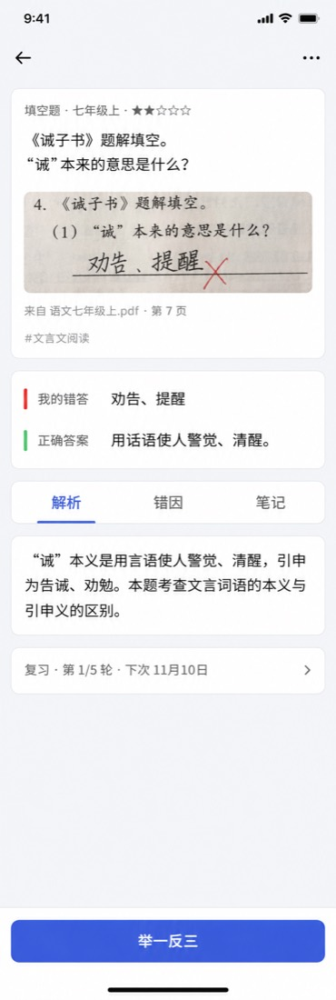

<p align="center">
  
</p>

# Smart Wrong Notebook (智能错题本)

[简体中文](README.md) | **English**

[](LICENSE) [](https://github.com/shuiguojiao/wrong-notebook/actions/workflows/ci.yml) [](https://github.com/shuiguojiao/wrong-notebook/actions/workflows/codeql.yml)

An AI-powered notebook for the questions you got wrong. Snap a photo or type a question, and AI recognizes it, solves it, tags it with knowledge points and rates its difficulty. Manage your notebooks, practice with similar questions, build printable exams and track how well you have mastered each question.

**Question reports**: Report recognition, formula, answer, explanation, tag or figure issues from question details. Admins review voluntarily shared snapshots without original images and reply; users can see the outcome. Limit: 30 reports per user per day. Reports are included in personal backups. See the [user guide](doc/wiki/en/User-Guide-en.md).

**Daily review reminders**: under Settings → General → Review reminders, choose Bark, ServerChan, PushPlus, WeCom/Feishu/DingTalk group bots or an administrator-approved custom webhook. Off by default, reminders count due questions by subject in the app time zone and include `/review` when `NEXTAUTH_URL` is set. Administrators can disable all sends with `REVIEW_REMINDERS_ENABLED=false`; both custom-address permissions default to off. The server must keep running. Credentials are included in personal plaintext backups. See the [reminder guide](doc/REVIEW_REMINDERS.en.md) for credentials, retry limitations and deployment.

Student navigation uses **Today (`/`) / Notebooks (`/notebooks`) / Collection (`/collection`) / Me (`/me`)** in both Notebook and Simple styles. At 768px and above, an 88px left rail includes an avatar and a Photo shortcut that focuses image entry on Today. Phones use four bottom tabs with safe-area clearance and no floating buttons. Me contains statistics, exams, recognition tasks, the background-task panel, interface style, theme, settings, AI Agent access, admin access (admins only) and logout. Logout clears local pending uploads and entry drafts first. Today shows recognition progress, failures and available results; Collection shows derived knowledge-point stickers with three-state filters and targeted practice links. Review sessions (`/review/session`) and checks (`/checks`) hide global navigation from initial loading. Only an empty queue or an error with no answerable content restores it. Save errors with a card still available keep focus, as does the review summary, which provides its own return link. Question details retain the tabs with actions above them.

Settings icon tabs retain screen-reader names on phones. Questions without a reference answer remain available for viewing and editing.

## Photo answers

Original review and similar-question practice support Keyboard / Handwriting / Photo. Non-touch desktop browsers label the last option Upload a photo. Take a photo opens the system rear camera, while Choose from library selects an existing image. Rotate right in the crop dialog and keep only your working. Images are processed locally for HEIC decoding and orientation, then the crop is resized to a longest edge of 2000px and JPEG-compressed starting at quality 0.85 to fit 1.5MB per photo. Images that cannot be opened prompt you to choose another.

Keep up to 3 photos, with retake, rotate right 90°, delete and add controls. Any text, ink or photo enables submission, and dots mark tabs with content. Grading sends handwriting first, then photos, up to 4 images in total. Photos stay in memory for the current answer and survive submission and Undo, keep writing. Changing questions clears them. When AI cannot read an image, Hard to read — retake returns to the Photo tab with all answer content preserved, beyond the three-second undo window and without saving an answer record. Self-assessment confirmation saves a vertically composed display image. Comparison and answer-history images open at full size when clicked.


Tap More paper at the bottom or write near the lower edge to extend the paper by 750 logical units, up to 3000. Undo, redo and rotation preserve paper height and existing ink. With Pencil-only writing enabled, drag the paper with a finger; otherwise use the 24px scrollbar on the right. The out-of-paper prompt switches to Photo. Long answers export in paper-aligned segments of 1300 logical units at 1000px wide, with up to 4 handwriting images and photos combined. Excess images block submission and prompt you to delete a photo or erase some ink, keeping your answer intact.

Expand on the toolbar opens focused writing. Tap the single-line question to view its full text, math and figures, with Collapse and the protected submit button on the right. Collapse or Esc keeps the same paper, ink and tool settings. New questions start collapsed; there is no draft page.


## 🌟 Highlights

- **🤖 AI recognition and explanations**: snap a photo, take a screenshot or type the question; AI recognizes it, writes the answer and analysis, explains the mistake, tags knowledge points and rates difficulty from 1 to 5 stars.
- **🔊 SVG animated explanations that talk**: AI turns the solution into a step-by-step animation with voice narration, and the animation waits for each step to be read before moving on. Two kinds of voice are available:

  | Voice | Sound | Cost |
  | :--- | :--- | :--- |
  | Browser voice (Web Speech) | Read by the device's built-in voice; sounds stiff, and the voice varies by device | Free |
  | Cloud TTS (MiniMax, Qwen, Zhipu GLM-TTS, StepFun, Volcengine Doubao Speech, Volcengine Agent Plan, OpenAI) | Natural, just like a real person explaining the problem, and the same on every device | Paid; **a Token Plan or similar subscription is recommended** over pay-as-you-go. Volcengine offers a [free trial quota](https://docs.volcengine.com/docs/ark/free-inference-quota?lang=zh) you can turn on by following its docs |

- **🆓 Works with free accounts**: choose the "MiniMax Code OAuth" channel and sign in with a MiniMax Code account in the browser, with no API key to buy; the app checks in every day to collect credits (see [MiniMax Code OAuth](#minimax-code-oauth)). New Volcengine users also get a [free inference quota](#volcengine-free-trial).
- **📚 A complete review loop**: auto-graded similar questions, AI mastery estimates, daily review at Ebbinghaus intervals, and printable exams built from your mistakes with per-question results.
- **📦 Self-hosting**: run with Docker or from source, and add the app to your phone’s home screen (PWA).

> This fork builds on the upstream wrong-notebook project, originally created by [wttwins](https://github.com/wttwins/wrong-notebook). The built-in knowledge-point library follows the Chinese K-12 curriculum. The interface supports Simplified Chinese and English.

## 🖼️ Screenshots

The screenshots below were captured from the running app on 2026-10-22 using English demo questions, answers, explanations, knowledge points and exams. The Student account and practice records are sample data. Click an image to view it full size.

**Notebook**: Notebook covers show subject colors, question totals, mastery progress and today’s review count. The simple style keeps the same structure without paper decoration. Search supports questions, knowledge points and 6-character IDs; press Enter on an ID to locate the question. At ≥1024px, a 320px notebook picker sits beside the selected notebook’s list; without a selection, a prompt appears on the right. The selected notebook has an outline highlight. Phones and portrait layouts open covers before navigating to a list. The header shows total, mastered and still-learning counts, with counted pill tabs. Review this notebook opens only this notebook’s part of the global daily-budget queue and is disabled when the count is zero. Questions are grouped within the current page by import date and source file name (the same file on the same day forms one group), falling back to the first source-text segment. Previews omit repeated opening instructions and show the question, first knowledge point, mastery status, Today marker and wrong-attempt count or next review date. The Today marker follows the same daily-budget queue as Today, and queued questions omit the duplicate next-review date. Questions due today but outside the budget retain their next-review date. Only renderable SVG figures get thumbnails, loaded on demand. Questions with source images only show a paperclip source link; questions without either show no image indicator. The filter panel opens from the bottom on phones and from the right on desktop, combining grade/term, chapter, knowledge point, time, paper group and question type; active filters can be removed individually. Tabs and the filter panel use All / Still learning / Mastered (`all / unmastered / mastered`). Still learning combines internal `new` and `reviewing` states. Legacy `?mastery=new` and `?mastery=reviewing` retain their original exact filtering. Export for print, selection, similarity comparison, retagging, renaming and deletion are in More. Long-pressing a row also enters selection, with export, comparison and deletion in the bottom bar. Add questions from the header tools on phones and desktop. Lists load lightweight fields, figure URLs and source indicators; answers and explanations load on demand. Initial URL filters `?mastery=unmastered|new|reviewing|mastered` and `?tag=<tag name>` are preserved. To review today means due questions within the daily budget; status statistics and badges combine `new` and `reviewing` as Still learning.


<details>
<summary><strong>Input and preferences: photo upload, text input, review before import and configurable duplicate detection</strong></summary>

Open entry from Photo / Album / More at the bottom of Today. The opened workspace and notebook pages share **Images**, **Text**, and **Files** tabs. Text offers **AI solve** or **Have an answer**. Switching entries preserves input and file summaries. Text and direct-entry drafts are stored per account and notebook in the current tab, survive refresh, and are cleared on sign-out or account deletion; they are not included in backups or transferred to other devices. If session storage is unavailable, drafts only survive within the current page. Direct entry shows the question and answer first, with optional details collapsed. On phones there are three separate entries: **Take photo** opens the camera directly, **Photo album** picks from your photos, and **Choose file** covers photos that do not show up in the album.

Select up to 20 photos from the album at once. A single photo still opens the cropper; multiple photos first offer **One question per photo** or **Multiple questions per photo**. The first creates recognition tasks; the second creates a split-preview batch per photo for review before solving individual questions. View results in Recognition Tasks; AI consent, quotas and the confirmation-before-import preference still apply. After submission, tap “Take the next photo” to open the camera immediately while recognition continues. Finish or discard staged question parts before selecting multiple photos.

The **Next: preview N questions** button creates preview batches; questions are only saved after the final import action. When all selected questions have answers, **Import as-is** is recommended by default. AI tagging and full solving remain optional, and edits, selection changes or undo do not override an explicit mode choice. The action bar states whether AI is used, and results distinguish saved, review-needed, failed and duplicate questions. A sole notebook is selected automatically, and a notebook can be created beside the selector.

For single photos, album selections, manually boxed questions and photo auto-splitting from the entry page, compressed photos and upload parameters are saved in this browser before transmission and removed only after successful submission. Network failures, timeouts and server errors keep the photos and retry with exponential backoff; going online, returning to the page or tapping Retry resumes uploads. Business errors such as exhausted quotas, missing AI consent or unsupported formats show a reason and stop automatic retries; resolve them and retry manually or delete the photo. Queues are isolated by account and cleared on sign-out or account deletion. They stay in this browser and are not transferred by backups or device changes. If IndexedDB is disabled or storage is full, direct upload is used without guaranteed retention of failed photos. Tasks already on the server remain available in Recognition Tasks.

Web photo imports and scanned PDF imports retain the uploaded full-page image and question regions for traceability. Questions split from one page share that source page, using the draft regions at save time. Single-photo imports use the full-page region, and scanned PDFs also retain the file name and page number. Duplicate imports append a mistake record while preserving the existing question’s source.

**Files** supports JSON (question exchange format v1), Word (.docx), Excel (.xlsx), CSV and PDF question bank files. After parsing, a summary shows the question count, parse errors, warnings and not-yet-imported fields; pick a target notebook and the questions are imported in batches, where they can be saved **as-is** without generating AI explanations (images are checked separately according to the automatic integrity setting). Up to 2000 questions per import. Excel / CSV templates can be downloaded from the import page. TXT / Markdown files selected under **Files** automatically load into the text box. Question-bank files selected under Text continue parsing automatically without being selected again. PDF files must have a text layer; scanned PDFs let you pick a page range (up to 20 pages per import) to convert to images, which are then recognized and split by AI — each page uses one AI split quota. For text-layer PDFs, every question is captured by default as a screenshot of its layout region and saved as the original image (can be limited to questions with graphics, or turned off), so formulas and figures survive even when the text layer is garbled. Screenshots are cropped by each question's layout region and merged into a single original image.

When saving direct entries or reviewed questions fails, the page keeps the specific reason and suggested next steps, distinguishing AI grade recognition, field-length or paper-group validation, sign-in status, database migrations and write permissions, and network or proxy errors. If AI grade recognition fails, enter a grade manually or switch to a fixed grade before saving again. After a timeout or disconnection, check whether the question was saved before retrying to avoid duplicate submissions.

Today (`/`) starts with the application-time-zone date, a greeting and estimated review minutes, then subject counts and estimates. Subject boxes are read-only, checked when a subject has reviews recorded today and no remaining questions in today’s budget queue. Pending subject rows enter single-subject review. Today and `/review` share the overview data source. At 1024px and above, tasks sit on the left and questions, status and entry on the right. At 768–1023px the order is tasks, status, questions, entry. Tablets initially expand six previews. Phones keep a single question-list toggle on the collapsed list card, with all questions available and math rendered. Recognition and pending checks share one paper card, hidden when empty. Loading uses skeletons and failures offer retry without fabricated zero counts. Entry comes last under “Got a new question wrong?” Photo and Album expand image upload. More offers Text, File and AI Agent. Switching an opened workspace retains upload queues, draft recovery, confirmation and the `?notebook=` target. Text entry says “Paste your question here” with collapsed formatting help. Sticker rewards and review streaks use the read-only progress service.

An empty check queue explains automatic checking for new imports and offers Back, Today and Notebooks exits. Check and similar-practice errors also provide in-page exits.


General settings control review before import, the per-user grade rule (fixed grade or AI recognition), SVG animated explanations, GeoGebra demos, the similarity threshold for duplicate detection and the mastered threshold. Paper groups (A/B/Other) can be customized in settings: rename default groups, add custom groups (e.g. Unit Test, Midterm, Final), deactivate or delete custom groups.

**Settings → General** offers **Interface style: Notebook / Simple** (Notebook by default), applied immediately and saved separately for each account in this browser on this device, without backup or cross-device sync. Light/dark theme remains independent. Admin pages, print preview and exam printing always use Simple; leaving them restores your choice.

Notebook-style h1 and h2 headings use a local ZCOOL KuaiLe subset (about 451.5KB), with system-font fallback for missing characters and no remote font requests. Body text, forms, buttons, formulas, Simple style and printing retain their existing fonts.


</details>

<details>
<summary><strong>Question details: formulas, difficulty stars, knowledge points and paper info</strong></summary>

Question details show a notebook and first-tag breadcrumb. The left paper card contains question type, grade/semester, clickable difficulty stars, Markdown and math content, figures and tags. Reliably parsed choices appear as separate cards, with green outlines and pale backgrounds for known correct choices. Wrong answers use high-contrast red ink with a fine strikethrough, and correct answers use green highlighting. Analysis, mistakes and notes are tabbed. Short existing error types appear as stickers, while long explanations stay in the body. Empty content offers an editing hint. At widths of 1024px and above, a 60% / 40% layout places the taped Original paper photo card, review progress and Try a similar question on the right. The preview is 180px high with yellow highlights at actual region coordinates. Legacy images without coordinates remain viewable. Captions show available file names, page numbers and source text, without inventing original question numbers. Dots count completed review rounds, with total rounds and the next date in the summary. Opening it retains schedule adjustments, mastery probability, practice history and result entry. Phones use one column with the main action above the four bottom tabs. Simple style retains the structure with paper, tape and handwriting decorations disabled.

The More menu has four groups. Editing contains Edit question and Replace original image. Let AI redo contains Regenerate solution, Re-recognize knowledge points and Regenerate figure, with Fix LaTeX shown only when formula issues are detected. Explanations contains animation and GeoGebra entries according to capability settings. The last group contains Copy question ID, Report a problem and destructive Delete. Tools retain existing panels, task recovery and overwrite/deletion confirmations.

Ungenerated animations and GeoGebra have no placeholders in the main content. Unified editing covers the question, correct answer, wrong answer and status, analysis, mistakes, notes, question type, grade/semester, notebook, paper group, tags and difficulty. Only changed fields are saved, and cancelling unsaved changes requires confirmation. Notes retain their separate endpoint. Partial failures preserve drafts and retries submit only remaining changes. Opening an original image shows a full-screen source viewer with blue question-region outlines, a dimmed background outside the regions, numbered multiple regions and initial focus on the first region. Pinch or wheel to zoom, drag to pan, or use the zoom and reset buttons. The footer shows the file name, page, date and import method. Cross-page questions offer a page selector, and older questions without a source page show their question image. The desktop sidebar previews the full page with region outlines.



</details>

<details>
<summary><strong>SVG animated explanations: step-by-step animations of the solution, with voice narration</strong></summary>

An English animated explanation of a hexagon coloring problem, showing region relationships and the recursive counting. The player supports pause, seeking, replay and full screen. Click the speaker for voice narration: the browser voice is free but stiff, while cloud TTS sounds natural, just like a real person (paid; a Token Plan or similar subscription is recommended).


</details>

<details>
<summary><strong>Review feedback: similar questions, answer history and AI mastery estimate</strong></summary>

Results from practice questions and exams are collected under the original question; expand a record to see the variant question and its answer. AI estimates your mastery from the actual answer history to help plan the next review.


</details>

<details>
<summary><strong>Exams and printing: generate exams from your mistakes and record results per question</strong></summary>

Generated exams keep each source question's ID and show every attempt, so you can trace the effect back to the original question.


The print preview can include an answer page and sets the answer space below each question: automatic by question type (less for fill-in, choice and true/false questions, more for worked problems with extra room per sub-question), a fixed none, small, medium or large, or manual per-question adjustment (saved automatically and reused next time); choice options listed one per line are laid out across 4, 2 or 1 columns by length, and standalone answer lines get writing room above them; download it as HTML, print it, or save it as PDF from the browser.


</details>

<details>
<summary><strong>Knowledge library: browse by subject, grade and chapter</strong></summary>

The tag library organizes knowledge points by curriculum level. Knowledge points now live under the **Stats** section: the "Knowledge Points" tab shows a tag system switcher at the top (visible once another tag system is imported), a usage frequency Top 20 card below (counted separately per tag system and subject; identically named knowledge points in different systems or subjects are not merged), and the standard tag library with custom tag management at the bottom (all shown and added per the selected system). This demo uses English sample tags for algebra and geometry.


</details>

<details>
<summary><strong>Statistics: mistake distribution, mastery rate, practice accuracy and trends</strong></summary>

Mistake statistics show total mistakes, still-learning count, mastered count and mastery rate, with a two-segment mastery-status progress bar, subject distribution and a trend chart. Filter by time range (last 7 days / 30 days / 6 months / all time) and subject. When a subject is selected, clicking the Still learning / Mastered cards jumps directly to the corresponding filtered error list of that notebook (the URL carries a `?mastery=` parameter to preset the filter). The trend chart shows daily or monthly data depending on the selected granularity, with two series: "Added" counts mistakes created within each bucket, and "Newly Mastered" counts mastered mistakes whose most recent mastery evaluation falls within each bucket (an approximation using the latest evaluation time as the mastery time; such mistakes may have been created before the range, so they are not restricted by the creation-time filter). Comparing the two series reveals whether your mistake notebook is shrinking or accumulating. When there is no data, a prompt guides you to record mistakes, and a retry button appears when loading fails.

Below the subject distribution and trend chart, the mistake statistics tab also shows a "Mistake Cause" card: the top half is a donut chart of attempt status (not attempted / wrong attempt / unknown) with counts and percentages, and the bottom half is a horizontal bar list of error types (name + count + progress bar). Error type is free text; only the top 7 by count are shown and the rest are merged into "Other". When no error types have been filled in yet, a hint is shown instead. The stats respect the current time-range and subject filters.

Next to the Mistake Cause card, the mistake statistics tab also shows a "Difficulty Distribution" card: for each difficulty level (1–5 stars), the total number of mistakes and the mastered count are displayed as a stacked horizontal bar, with unrated mistakes listed separately. When there are no rated mistakes at all, this card is hidden.

The mistake statistics tab shows a Collection summary and entry from the same progress service, using all questions and the subject filter independently of the statistics date range. The legacy `/api/stats/weak-tags` endpoint remains compatible.


Practice statistics show total practice, accuracy (correct / attempted) and active days, with distribution and trends by subject and difficulty; time-range and subject filters are also supported. When there is no data, a prompt guides you to practice, and a retry button appears when loading fails. The practice stats tab also includes a "Learning Calendar" heatmap at the top: a GitHub-style grid showing daily learning activity (recorded mistakes + practice count) for the last 26 weeks, with month and weekday labels along the top and left edges, along with current streak, longest streak and total active days. Recording mistakes counts as activity, so the heatmap is visible even when there are no practice records yet. At the bottom of the practice stats tab there is also a "Repeated Mistakes" ranking: the top 10 questions answered wrong 2 or more times within the selected range (including similar-question practice, exam answers, manual entry and duplicate-import wrong records). Each row shows a question preview, subject, wrong count, the most recent wrong date and the review status; clicking a row opens the question details, highlighting questions worth revisiting. When there are none, a short hint is shown instead.


</details>

## ✨ Features

### Input and recognition

- **📷 Many ways to add questions**: upload images, paste from the clipboard (Ctrl/⌘+V), take a screenshot, or type the question (Markdown and LaTeX supported). Crop images (zoom with the mouse wheel, a pinch or the zoom buttons for precise selection), or select several questions on one image to import them in a batch.
- **🤖 AI recognition and solving**: AI extracts the question text, answer, analysis, the student's wrong answer and the cause of the mistake, identifies the subject and picks tags from the knowledge library. Turn on "Review before importing" in **Settings → General** to check and edit results before saving.
- **📷 Photo formats and compression**: the real format is detected from the file content (a wrong extension does not matter), with support for JPG, PNG, WebP and HEIC/HEIF. If the browser can decode HEIC (for example Safari) it is used directly; otherwise a decoder is loaded on demand, the photo is converted to JPEG and rotated upright before cropping, and a specific reason is shown if it still cannot be decoded. The crop preview uses a thumbnail while the final crop comes from the original. Output is limited by a 4096 px long edge, about 4.9 megapixels and 1.5 MB together; JPEG quality stays at 0.8 or above and the image is scaled down instead of compressed further, so small text and formulas stay sharp. The actual time of reading, converting, cropping and compressing, uploading, AI recognition and saving is shown, while percentages remain per-stage estimates.
- **🧩 Multiple questions at once**: paste several questions into **AI solve** and they are split by their numbers (local rules, no AI call); options, sub-questions and reading passages stay with their question, while titles and name/date lines are left out. Numbers that look like sub-questions of one question are kept together by default, and unnumbered text can be split with **Split with AI**; when wrong numbers (such as OCR errors) make the local split go wrong, tap **Split wrong? Split with AI**. When one question spans several sheets, tap **Rest is on another sheet** while cropping a single question to save that part, then take the next photo and frame the next part; the parts are joined top to bottom into one image for recognition (up to 4 parts). For photos, choose **Auto split** and a model with image input finds every question and its position on the photo. You confirm the split on a preview page first: select or clear, edit, split at the cursor, merge, reorder, delete and undo, and adjust photo areas on the original image. When a question continues on the next page, tap **Continues on next page** on it (shown for questions marked as possibly cut off and for the last question on each page): its part on this page is placed above the next page in one image, which is auto split as the next batch, and the question is moved out of this batch. For text questions, **AI fix text** removes scratch work and fixes OCR typos; every change is marked and only replaces the original after you accept it (results that change or add numbers are discarded). Only then is each question solved (photo questions are cropped by area and go through the same recognition as a single photo), then imported directly or reviewed one by one according to **Review before import**. When every selected question already has an answer, you can also choose **Import as-is**: no AI explanations are generated; background integrity checks for images run separately according to settings and count toward quotas, and each question is saved straight from the draft's text, answer, analysis and other fields. The batch appears as "Batch of N questions" under Recognition tasks and survives refreshing, locking the phone or closing the page; failed questions can be retried on their own without repeating finished AI calls or imports.
- **📮 Recognition tasks**: photos and box-selected questions are recognized on the server after upload. Tasks and results are stored in the database and do not depend on the page that started them, so once the upload finishes you can leave the page, lock your phone or keep using the app. The **Recognition** entry in the header shows how many are running and any unread results, refreshes as soon as the app returns to the foreground, and lets you continue reviewing, open the saved question or retry a failed task. With "Review before importing" on, the result is kept as a draft awaiting review; with it off, the server saves the question directly using the same duplicate, grade and paper-group rules as a manual save. Repeated uploads or confirmations never save twice. After a server restart, finished results can still be opened and interrupted tasks show as failed so you can retry. Drafts and failed tasks are kept until you handle them; saved tasks are kept for 7 days.
- **🎓 Grade rule for new questions**: choose a fixed grade or AI recognition per account under **Settings → General**. Fixed mode uses the selected grade and semester, falling back to the account's current grade if unset. AI infers the grade from the question and leaves it unset when uncertain. Applies to images, text, batch selection and Openclaw; manual choices take priority. Direct entry without a grade uses one short AI request, counted toward your daily limit; duplicates do not trigger it. Existing questions and restored grades are preserved.
- **🔁 Duplicate detection**: on import, question text is compared by similarity. Above the threshold (90% by default, adjustable in settings) the question is not imported again; a new wrong attempt is recorded on the original instead.
- **🆔 Question ID**: every question has a 6-digit ID you can copy or type into the notebook to open it directly. Printed questions and exams show the source ID so you can find the original when entering results.

### Question content

- **∑ LaTeX formulas**: formulas in questions, answers and analyses are rendered with KaTeX, supporting `$…$`, `$$…$$`, `\(…\)` and `\[…\]`; switch between source and preview while editing. Open **More → Fix LaTeX** on the detail page to repair detected formula syntax errors with AI. Multiline formula delimiters are normalized when displayed, even when attached to the formula content; existing questions do not need to be re-analyzed.
- **📝 Regenerate the solution**: **Regenerate full solution** on the details page asks AI to rewrite the answer and analysis (with confirmation before overwriting); knowledge points and the cause of the mistake stay unchanged.
- **🖼️ Question figures**: during recognition AI redraws figures as SVG, which is used on the details page, in printouts and in exams. For a saved mistake with a figure, set **Figure display scale** (10–200%, default 100%) and **Figure alignment** (left / center / right, default center) on its details page; exam papers with figures also support adjusting the scale and alignment per question or uniformly across the exam. Saved settings apply to display and printouts and are restored from backups. Click the original-image thumbnail to check the photo, or use More to replace/add it.
- **⭐ Difficulty stars**: on import AI rates difficulty from 1 to 5 stars following the star scale of a well-known Chinese math competition textbook series (1–2 stars: textbook and school extension, 3–4: regular math olympiad, 5: hardest competition problems). You can change it manually; questions with 4 stars or more go to paper B by default.
- **🏷️ Knowledge-point tags**: each notebook is created for a school stage (primary / junior high / senior high) and a subject (cannot be changed later). Primary school supports math, English and Chinese; the built-in Chinese chapters and knowledge points cover grades 1–6, junior high and senior high. AI picks tags from all knowledge points of that stage and subject. Custom tags are supported, and AI can re-tag the knowledge points and difficulty of one question or a whole notebook. Admins can import the PEP curriculum tag system (mainly math, also Chinese, English, physics, history, geography and morality & law; about 2,800 knowledge points) by uploading [topics.json](https://raw.githubusercontent.com/xiaoyang111222/cn-math-taxonomy/HEAD/data/topics.json) from [cn-math-taxonomy](https://github.com/xiaoyang111222/cn-math-taxonomy) in **Settings → User Management → PEP Curriculum Knowledge Points**. Once imported, a tag system can be chosen when creating a notebook. It coexists with the built-in system and cannot be changed after creation.

### Explanations and demos

- **🎬 SVG animated explanations**: AI generates step-by-step SVG animations of the solution that stay paused on the first frame when the page opens or the animation changes; click Play to start. The player supports play/pause, seeking, replay and full screen. Animation text follows the interface language; Chinese and English versions are kept separately, and switching the language shows the matching version automatically. On by default; turn it off in **Settings → General**.
- **🔊 Voice narration**: click the speaker icon in the player; the animation waits for each step to be read before moving on, and the speed is adjustable. Choose the browser voice or cloud TTS (see [Cloud voice narration](#-cloud-voice-narration)). Older animations without a narration script read the on-screen subtitles, or click **Add narration** to have AI write only the script while keeping the picture unchanged.
- **📐 GeoGebra demos**: for math and physics questions, AI can generate interactive GeoGebra figures. Off by default; turn it on in **Settings → General**.
- Generated animations and GeoGebra demos can be deleted (with confirmation).

### Review and practice

- **🔄 Practice similar questions**: generate variant questions (fill-in-the-blank or free response) on the same knowledge point, choose the difficulty and submit an answer: it is checked automatically (local matching checks identical conclusions only for text-only answers when no reasoning is required; proofs and justification questions go to AI to check the reasoning, and other answers are compared by AI with the reference answer), and you can change the result before saving. The most recently generated question and solution are kept for each mistake and shown directly next time; click Regenerate for a new one. Saving a result also preserves your answer, working notes and the automatic grading reason in the expandable history. If another page regenerates the question, the old page preserves your work and reports the change instead of grading your answer against the new question.
- **📈 Mastery probability**: AI estimates how likely you have mastered each question from the answer history of practice and exams. The student interface shows **Still learning** and **Mastered**. Internally, `new` has no answered practice records, `reviewing` has records with probability below the threshold or not yet evaluated, and `mastered` has records with probability at or above the threshold. The threshold is 50% by default and each user can adjust it in settings.
- **📅 Daily review**: schedules questions by subject and answer confidence, reducing repeats when you are confident. Today and the retained `/review` route share the task note, read-only subject progress and math previews. Start all or one subject within the remaining minute budget. The layout and entry flow are described above. Shared delimited prefixes across all notebook names are omitted on this page, while single notebooks and names without a shared prefix stay intact. Question previews in today’s list and the review summary render math, keeping formulas whole or stopping before a formula. Wide formulas can be scrolled horizontally. Set **Daily review minutes** under **Settings → General → Review** (default 30, range 10–180 in steps of 5). Subject defaults adapt to the median of recent valid answer times. Priority and subject rotation fill the budget; unscheduled backlog stays hidden. Review sessions hide global navigation from initial loading. Empty queues and errors with no answerable content restore the shell. Save errors with a card still available and the review summary keep focus; the summary provides its own return link. The header shows close, subject, question number and total, estimated time left in the queue, skip and a thin progress bar. At widths ≥1024px, answering uses 55% / 45% question/answer columns. The paper card shows the full passage and question, scrolling within the left column for long content. The note panel on the right contains My answer, Type / Handwriting / Photo tabs, optional reasoning and Hand in and check my answer at the top, with the input filling the remaining height. At 768–1023px, the question sits above the answer and submission sits at the top of the answer panel. On phones, questions longer than about six lines start as a summary with Read full question. The bottom answer drawer is non-modal and supports dragging, clicking its handle or pressing Up/Down to expand or collapse. Changing the drawer or question expansion preserves text and ink. With the software keyboard open, the drawer follows the visual viewport while the question remains scrollable and submission stays reachable. Original images and source controls are only mounted after submission. Afterwards, the Original paper photo card opens the full-page source. Review handwriting defaults to lined paper, with tools above the canvas and palm space. Other contexts default to blank paper. Rotation preserves logical coordinates and export includes only ink. Tabs mark existing content with dots, and Write your reasoning (optional) expands a text field. Empty submission asks for an answer. Command/Ctrl+Enter, duplicate-submit protection, drafts and close confirmation remain available. Older snapshots without estimates show question progress alone.  Submission switches the same card to comparison and hides skip. The passage starts as an expandable three-line summary. Landscape retains 55% / 45% question/result columns, with a taped Original paper photo card below the passage. Phones stack the content vertically. At widths ≥1024px, answering and comparison cards fit the viewport below the progress bar with bottom safe-area clearance. Each column scrolls independently, with submission at the top of the answer panel and self-assessment buttons at the bottom of the right column. The photo card mounts only after submission and opens the full-page source viewer with multiple-region framing. Matching text-only answers are marked correct locally without AI (except questions requiring reasoning). Other grading runs in the background. Headings show Got it right, Almost there, Checking your answer…, or Please compare the answers yourself. One whole-question group compares What you wrote / Previous wrong answer / Reference answer, with a green circular correct stamp or an orange square almost stamp. A yellow note shows a one-sentence grading summary with collapsible details. Recognized handwriting, detailed analysis and similar practice remain collapsed. The self-assessment prompt asks how you feel about the question now. For a correct grade, Not quite sure yet saves correct + unsure and the primary Got it, next question saves correct + sure. For a wrong grade, See you tomorrow saves wrong. I think I got it right only switches to the two correct-answer confidence choices, and saving requires another selection. While grading or after failure, Got it wrong / Not quite sure yet / Got it save wrong / correct + unsure / correct + sure. Number shortcuts 1 / 2 / 3 follow the currently displayed save-button order and ignore focused inputs. Failed saves retain the answer for retry. An approximately five-second undo notice matches the card width above the action bar and restores the previous graded screen. Empty days show no start button. Viewing originals uses no AI quota; AI grading does. For unresolved user-visible check issues, the post-submission Original paper card retains a yellow dot and “This question may differ from the original · View image”. Expand it and choose “Take a look” to open `/checks?id=QUESTION_ID` with that question first. The hint stays hidden while answering, and the question remains in daily review.
- **🧾 Mistake exams**: draw questions at random by notebook, knowledge point, question type and mastery, and build a printable exam from similar questions (AI-generated) or original questions (no AI quota used, ready to print immediately). Turn on "Generate A/B papers simultaneously" to create two parallel papers with non-overlapping questions in one go. Each question can have its own score and the paper total is summed automatically; a "Group by question type" switch groups questions into sections such as choice and fill-in-the-blank. After finishing, enter results per question; they are added to the original question's answer history.
- **🖨️ Print mistakes**: print filtered questions with your choice of question text or original image, answer, analysis and knowledge points, adjust image scale and global/per-question blank space (per-question space is saved automatically), with choice options laid out across columns by length, then print or save as PDF.
- **Continuous review**: freezes the queue at the start; direct session visits also use today’s remaining minute budget. Skip without saving, confirm before discarding a draft, and see a completed-count notice on returning to review home. The post-grading **Try a similar question** link opens existing practice in a new tab, preserving the review. The summary shows **Correct this time / See you tomorrow / Fully mastered** for saved answers. Skips appear separately and do not count as completed. Mastery counts only a transition from unmastered to mastered across this session; the progress service takes a snapshot at session start and another at wrap-up. Failed reads or pending evaluation show **– · awaiting confirmation**. The **Today’s progress** paper card groups clickable math previews by correct and incorrect results, without inventing previous mistakes. The subtitle shows saved answers and active answer minutes rounded up. A dated **Done** stamp and **Today’s review is all done!** require no skips and a fresh, empty all-subject today queue. Incomplete tasks, failed verification and extra practice show **This group is done!** without a daily completion stamp. **Finish for today** returns to Today; **Want more? Try 5 more questions** takes up to five: backlog first, otherwise suitable questions due within three days. Questions already answered today are excluded. Reopening writes no records, today’s answered count uses unique questions, and undo restores counts and eligibility. The daily completion stamp also shows the review streak. A knowledge point newly mastered by this group shows **New sticker earned**. Early correct answers anchor the new interval to the original due date. Question details show review progress and the next date, with manual completion and restart. Review completion is independent of AI mastery. The next review date uses the least-loaded day in its window, based on estimated minutes.
- **iPad + Apple Pencil handwriting**: Original reviews and similar-question practice support keyboard/handwriting/photo switching, with typed text, strokes and photos submitted together. Includes pressure, palm rejection, pen/eraser, undo/redo, paper backgrounds and a side-by-side wide layout with more room for answers. Paper fills the container; rotation preserves strokes and export includes ink outside the current view. Handwritten images go to the configured multimodal AI for grading; confirming the result saves the image, transcription and grading reason. Full backup format is 17, preserving daily minutes, confidence, active duration and manual adjustments, with older backups supported. See [Practice and Exams](doc/wiki/en/Practice-and-Exams-en.md).

Grading accepts up to 4 ordered answer images. Legacy `answerImage` and new `answerImages` are merged and deduplicated with the legacy image first, with PNG/JPEG/WebP and a 1.5MB limit per image. Unreadable images return `correct: null` and `unreadable: true`, keeping the reason for manual self-assessment. Grading uses the separate originals. Comparison and confirmed records use one locally composed vertical image, initially 1000px wide with a white background and 24px light-gray separators, progressively JPEG-compressed and proportionally resized when needed to fit 1.5MB. The handwriting canvas exports one image, which can be submitted with up to three photos.

On iPad (≥768px), the submit button sits at the top right beside the keyboard/handwriting/photo switch and is at least 44px high. Phones retain a bottom submit bar, with ink tools above the paper and 48px of content clearance. Touch submission is ignored while Pencil is down and for 800ms after lifting it. Pen and keyboard submission remain available. Submission opens comparison immediately. For three seconds, “Undo, keep writing” restores text, ink and photos, aborts grading and discards late results. Original-review timing resumes from its paused total. Answer records are saved only after self-assessment confirmation. The existing post-save undo notice remains separate. Native non-passive stylus touch handlers prevent accidental scrolling while retaining finger-scroll settings. Missing pointer-up events, subsequent pen-down events and backgrounding preserve collected strokes. Newly collected pen pressure maps to 0.35–1 with thinning 0.45. Simulated pressure for other pointers retains its behavior, and existing point data needs no migration.

### Management and statistics

- **🔍 Filters**: filter by mastery, date range, knowledge point, question type, grade and term, paper level and more; supports bulk actions and comparing the similarity of two questions. Selected questions can be exported as JSON, Excel or Word (the Excel columns match the question bank import template, so the file can be re-imported directly).
- **📊 Statistics**: mastery rate, trends and subject distribution for both mistakes and practice, with time-range and subject filters.
- **⏳ Background tasks**: Me → Background tasks shows the progress of long-running jobs such as recognition, AI generation, animation voice, bulk tagging and exam generation. Jobs keep running on the server after you leave the page. Photo recognition results are also kept in **Recognition**.
- **💾 Import and export**: export or import data backups in **Settings**, including notebooks, questions, system and custom tags, practice and answer records, exams, personal preferences and synthesized cloud voice. Tags are restored by tag system and parent path, keeping identically named chapters and knowledge points under different grades separate and reconnecting questions to their specific tag nodes. Account credentials and AI settings are not included.
- **🌗 Dark mode**: the theme control in Me switches between Auto (follow system), Light and Dark; Auto is the default. The choice is saved per account, so it carries over when you sign in on another device.
- **🕒 Application time zone**: Beijing time by default and changeable by administrators; dates and statistics follow the application time zone. See [TIME_ZONE.md](doc/TIME_ZONE.md) (Chinese).
- **🔑 One-time setup link**: fresh installs no longer ship an admin with a fixed password. On first start the server generates a setup link that works only once; open it to choose the admin email and password. The desktop and standalone Android apps open it automatically; on fnOS you enter the admin email and password in the install wizard instead; Docker, npm and source runs print it in the startup log (the token is also in `config/setup-token` in the data directory). Instances upgraded from earlier versions keep their accounts.
- **🛡️ AI data sharing consent**: before first use, each account sees a notice listing the data sent to the third-party AI provider and the current provider; nothing is sent until the user agrees. If the user declines, AI features are unavailable and everything else keeps working. Consent can be withdrawn any time under **Settings → Account**.
- **🧭 Setup wizard**: on first sign-in the admin goes through a wizard: change the default password (only for the default admin of earlier versions) → set up an AI provider (free MiniMax Code recommended) → create the first notebook. The last two steps can be skipped, and the wizard can be run again from **Settings → User Management**. Instances already in use are not interrupted after upgrading.
- **🔐 Multiple users and admin console**: sign-up and sign-in, with data isolated per user. New sign-ups are off by default (the sign-in page then hides the sign-up link and asks visitors to contact the administrator) and can be turned on under **Settings → User Management**, where admins can also cap daily AI use per user and see today's usage. Administrators open the admin console from **Settings → User Management** to view usage statistics and enable, disable or delete users. Regular users can delete their own account under **Settings → Danger** by entering their password, which permanently deletes the account and all of its data (admins cannot delete themselves). Sign-in and sign-up limit repeated failures to block password guessing.
- **🐞 Debug logs**: when something goes wrong, an admin turns on debug mode under "Settings → User Management", reproduces the problem, then exports the debug log (JSON) and sends it to the author. Debug mode records every server log, including `debug` level, plus frontend errors; API keys, passwords and tokens are removed on export. The log lives in memory only, debug mode turns off after 24 hours, and a restart clears it.
- **AI Agent integration**: create personal access tokens in **Settings → Account**, for MCP or structured REST imports without server AI, reusing duplicate detection and tag saving, with revocation and optional expiration. Credentials are excluded from backups. Requests are rate-limited after authentication and before body reads, with at most 2 concurrent body reads per user. Image URL DNS resolution and download share a 10-second total timeout. Download a token-free Skill zip from the same settings section to extract for Codex or upload to WorkBuddy. Settings show the Skill version, a copyable Codex update command and a setup prompt for your own agent that configures MCP, installs the Skill and verifies the connection without including the token. Agents notify users of newer versions while continuing the import; updates require consent. `GET /api/agent/skill` supports token-authenticated downloads with shared rate limits; WorkBuddy users can upload the latest zip to replace the Skill. The shared import Skill v5 standardizes math in LaTeX and requires question selection, region previews and self-review before submitting scans through `sourcePage`. Its `scripts/images.py` reuses page IDs, verifies provenance and saves server crops to temporary files for inspection, while preserving legacy `imagePath`, attachment and SHA-256 checks. Failures retain receipts without automatic resubmission. Reports include saved counts, links and unresolved questions. Writes currently accept one source page per question, and duplicate-attempt provenance readback remains pending. Synchronous rules return `check: { status, issues }` to agents and rerun after edits; proofreading cards show only missing referenced figures, with other issues reserved for agents. See [AI Agent integration](doc/wiki/en/AI-Agent-Integration-en.md). Imported items can also be searched, read (including original images), patched or deleted; duplicate-import attempts can be corrected or removed separately. Writes require a current revision to prevent concurrent edits from being overwritten, and corrections never add attempts. The **AI Agent** entry tab guides client configuration, token creation, connection status, Skill installation and example prompts; Claude Code and Cursor configurations reference the token through environment variables.
- **🔌 Openclaw integration**: an external Openclaw agent can upload question images in bulk via `POST /api/openclaw/batch-upload`; see [Environment variables](#-environment-variables).

## 🚀 Quick Start

Ordered from easiest to most hands-on. Fresh installs have no default account: the first start generates a one-time setup link where you choose the admin email and password, then the setup wizard helps you set up an AI provider and create your first notebook. The desktop and standalone Android apps open the link automatically; for Docker run `docker logs wrong-notebook 2>&1 | grep initialize`; npm and source runs print it in the terminal. If the link host is `localhost`, replace it with the server address when opening it from another device (or set `NEXTAUTH_URL`). Until an admin exists, the sign-in page shows these instructions too.

Installers can be built locally with `scripts/package/`; see [doc/INSTALL_PACKAGES.md](doc/INSTALL_PACKAGES.md).

### Option 1: Docker image (recommended for servers and NAS)

Build the Docker image from source (see below), or use `ghcr.io/shuiguojiao/wrong-notebook:latest` after this fork’s Docker workflow has successfully published it. The retained workflow supports `linux/amd64` and `linux/arm64`; check the fork’s container packages for available tags.

1. **Prepare directories and a secret**:

   ```bash
   mkdir -p wrong-notebook/data wrong-notebook/config
   cd wrong-notebook
   openssl rand -base64 32   # use the output as NEXTAUTH_SECRET
   ```

2. **Start the container** (either way):

   ```bash
   docker run -d --name wrong-notebook \
     --restart always \
     -e NEXTAUTH_SECRET="secret-from-previous-step" \
     -e NEXTAUTH_URL="http://your-ip-or-domain:3000" \
     -p 3000:3000 \
     -v "$(pwd)/data:/app/data" \
     -v "$(pwd)/config:/app/config" \
     ghcr.io/shuiguojiao/wrong-notebook:latest
   ```

   Or download [`docker-compose.yml`](docker-compose.yml) into the current directory, set `NEXTAUTH_SECRET` (and `NEXTAUTH_URL`), then run `docker compose up -d`.

3. **Sign in**: open `http://your-ip-or-domain:3000`.

4. **Upgrade**: pull the new image and recreate the container. Data stays in the mounted directories; startup runs database migrations and fills in missing built-in Chinese tags while preserving existing tag IDs and question links. Back up the `data/` directory before upgrading.

   ```bash
   docker compose pull && docker compose up -d
   # With docker run: docker pull the new image, docker rm -f wrong-notebook, then run the docker run command above again
   ```

Data lives in the mounted `data/` (SQLite database) and `config/` (AI settings saved from the web UI, cloud voice cache, etc.) directories. **Settings → About** and `/api/health` show the running version. For HTTPS, see the [HTTPS setup guide](doc/HTTPS_SETUP.md) (Chinese) and `docker-compose.https.yml`.

### Option 2: Run from source

1. **Requirements**: Node.js 22 or later (24 recommended) and npm. Server backups and the verifier require Node.js 22.13 or later; older versions report `BACKUP_NODE_UNSUPPORTED` without preventing application startup.
2. **Clone and install dependencies**:

   ```bash
   git clone https://github.com/shuiguojiao/wrong-notebook.git
   cd wrong-notebook
   npm ci
   cp .env.example .env   # fill it in as described in Environment variables
   ```

3. **Initialize the database**: create the schema and the admin account, then import the system knowledge points (same as the Docker build):

   ```bash
   npx prisma migrate dev
   npx prisma db seed
   npx ts-node --compiler-options '{"module":"CommonJS"}' scripts/rebuild-system-tags.ts
   ```

4. **Start the dev server**: `npm run dev`, then open `http://localhost:3000`.

   For LAN access, set `NEXTAUTH_URL` in `.env` to the full address used by your devices, including the port, then restart the dev server. Its hostname is automatically added to the development resource allowlist so scripts and hot reload connections can load.

### Option 3: Build the image from source

Build it yourself if you change the code or need unreleased changes. The build runs all tests inside the image and produces a production build:

```bash
docker build -t wrong-notebook:local .

docker run -d --name wrong-notebook \
  -e NEXTAUTH_SECRET="your_secret_key" \
  -p 3000:3000 \
  -v "$(pwd)/data:/app/data" \
  -v "$(pwd)/config:/app/config" \
  wrong-notebook:local
```

With `docker-compose.yml`, change `image` to `wrong-notebook:local`.

## ⚙️ AI and voice configuration

AI settings are changed in the web UI and take effect when saved, without restarting:

1. As an administrator, open **Me → Settings** and open **AI Provider**.
2. Choose a provider and fill in the API key, base URL (or endpoint) and model (or deployment name). The provider links to its official API docs, and the API key and model fields link to how to get a key and the model list.
3. Click **Test connection** to check text and image recognition; on failure the provider's original error is shown. Settings are stored in `config/app-config.json` and take precedence over `.env`.
4. **Voice narration** further down the same page switches between the browser voice and a cloud voice. The **Prompts** tab lets you customize the prompt templates for recognition and similar-question generation.

AI settings, prompts, connection tests and model lists are admin-only. Regular users can only change their own preferences in **Settings → General**.

Grading checks equivalent results for calculation questions and the required reasoning for proofs and justification questions. Local matching only marks answers correct when no reasoning is required; other cases go to AI grading.

GeoGebra text, inequalities and caption parameters are checked against a shared command list; regeneration includes actual execution errors as feedback.

The application always supplies the output contract, field languages, grade scope and candidate-tag rules, including for older custom templates with missing variables. Recognition preserves the original question and student work; explanations and mistake analysis follow the interface language, while stored subject, grade and tag names remain unchanged. AI tags are filtered against the candidate list and deduplicated; manually added tags are unaffected. Mastery evaluation includes its evaluation time and practice intervals.

### Supported AI providers

The official Chinese model channels call each vendor's OpenAI-compatible API, so only an API key is required; when the base URL and model are left empty, the defaults below are used. For the international site, change the base URL to its address.

| Provider | Recommended setup | Default base URL | Default model |
| :--- | :--- | :--- | :--- |
| MiniMax | [MiniMax platform](https://platform.minimax.io) | `https://api.minimax.cn/v1` (international `https://api.minimax.io/v1`) | `MiniMax-M3.1-Flash` |
| MiniMax Code OAuth | **Free account**, browser sign-in; see [below](#minimax-code-oauth) | Fixed endpoint | `MiniMax-M3.1-Flash` |
| Zhipu GLM | [Z.ai platform](https://z.ai) | `https://open.bigmodel.cn/api/paas/v4` (international `https://api.z.ai/api/paas/v4`) | `glm-5.3-flash` |
| DeepSeek | [DeepSeek platform](https://platform.deepseek.com) | `https://api.deepseek.com` | `deepseek-v4-flash` |
| Kimi | [Kimi platform](https://platform.kimi.com) | `https://api.moonshot.cn/v1` (international `https://api.moonshot.ai/v1`) | `kimi-k3.1-pro` |
| Qwen | [Alibaba Cloud Model Studio](https://bailian.console.aliyun.com), Token Plan recommended | `https://token-plan.cn-beijing.maas.aliyuncs.com/compatible-mode/v1` (pay-as-you-go `https://dashscope.aliyuncs.com/compatible-mode/v1`) | `qwen3.8-max` |
| StepFun | [StepFun platform](https://platform.stepfun.com), Step Plan recommended | `https://api.stepfun.com/step_plan/v1` (pay-as-you-go `https://api.stepfun.com/v1`, international `https://api.stepfun.ai/v1`) | `step-5-preview` |
| Volcengine Doubao | [Volcengine Ark](https://console.volcengine.com/ark), pay-as-you-go | `https://ark.cn-beijing.volces.com/api/v3` (international `https://ark.ap-southeast.bytepluses.com/api/v3`) | `doubao-seed-evolving` |
| Volcengine Agent Plan | Dedicated [Agent Plan](https://ark.volcengine.com/region:cn-beijing/docs/82379/2160841?lang=zh) key; the plan includes Doubao speech synthesis | `https://ark.cn-beijing.volces.com/api/plan/v3` | `doubao-seed-evolving` |
| Volcengine Coding Plan | [Coding Plan](https://www.volcengine.com/docs/82379/1928261), Ark API key | `https://ark.cn-beijing.volces.com/api/coding/v3` (do not change it to `/api/v3`, which is not counted toward the plan) | `doubao-seed-evolving` |
| Volcengine (free trial) | **Free inference quota** for new users; see [below](#volcengine-free-trial) | `https://ark.cn-beijing.volces.com/api/v3` | `doubao-seed-evolving` |
| Anthropic and compatible APIs | [Claude Console](https://platform.claude.com/) | `https://api.anthropic.com` (without `/v1`) | `claude-sonnet-5-5` |
| Azure OpenAI | Azure portal → OpenAI resource → Keys and Endpoint | Your resource endpoint and deployment name | Deployment name |
| OpenAI and compatible APIs | [OpenAI Platform](https://platform.openai.com/api-keys); several configurations can be added and switched | `https://api.openai.com/v1` | `gpt-6.1-sol` |
| Google Gemini | [Google AI Studio](https://aistudio.google.com/apikey) | Official URL | `gemini-2.5-flash` (`gemini-3.8-flash` recommended) |

> **Compatible APIs**: the OpenAI provider works with any third-party service that implements the OpenAI API format (such as SiliconFlow), and the Anthropic provider with services that implement the Messages API. Set the base URL to the service's address and enter the platform's full model ID. Thinking output from reasoning models is ignored.

#### MiniMax Code OAuth

**Free MiniMax accounts are supported**: sign in with a MiniMax Code account in the browser. No API key or paid plan is needed.

- **Automatic daily check-in**: once signed in, the app checks in every day and collects the MiniMax Code check-in credits (streaks earn more), so you don't need to open the client.
- **Uses free credits**: AI calls such as recognition, explanations, similar-question practice and grading use the account's free credits. The remaining credits are shown on the settings page.
- **Default model `MiniMax-M3.1-Flash`**: tested and working, with image input; `MiniMax-M3`, `MiniMax-M2.7` and others are also available.

To set it up, choose MiniMax Code OAuth in "Settings → AI Provider", click "Sign in with browser" and finish authorizing on the MiniMax page that opens. The settings page shows the login status, the remaining credits and whether today's check-in was done automatically.

The credentials are stored in `minimax-code.json` in the server's config directory (next to `app-config.json`, not included in data backups), and the access token is renewed automatically before it expires. Once signed in, the server checks every hour and collects the MiniMax Code daily check-in credits if today's check-in (Beijing time) has not been done yet. You can turn auto check-in off or check in right away on the settings page. This channel uses the sign-in of the MiniMax Code desktop client (OAuth device authorization) rather than an official open API, so MiniMax may change or restrict it at any time. Follow MiniMax's terms of service.

#### Volcengine (free trial)

Every Volcengine account gets a [free inference quota](https://www.volcengine.com/docs/82379/1399514) for each model (500,000 tokens per model, per the official docs). Turn on worry-free trial mode under Activation Management in the Ark console: calls only use the free quota and pause when it is nearly used up, so you are never charged. Choose the **Volcengine (free trial)** channel and enter your Ark API key. To keep going after the quota runs out, verify your identity and switch to the **Volcengine Doubao** channel or the matching plan channel.

### 🔊 Cloud voice narration

Animation narration uses the browser's voice by default (free, but stiff). Admins can switch to cloud TTS (natural, just like a real person) under **Settings → AI → Voice narration**:

| Cloud voice | API key | Default model / voice |
| :--- | :--- | :--- |
| MiniMax (M Plan recommended) | Shared with the MiniMax channel | `speech-2.8-hd` / `male-qn-jingying` |
| Qwen (Token Plan recommended) | Shared with the Qwen channel | `qwen-audio-3.0-tts-plus` / `longanlufeng` |
| Zhipu GLM-TTS (GLM Coding Plan recommended) | Shared with the Zhipu GLM channel | `glm-tts` / `xiaochen` |
| StepFun (Step Plan recommended) | Shared with the StepFun channel | `stepaudio-2.5-tts` / `qingniandaxuesheng` |
| Volcengine Doubao Speech (free trial available; resource pack recommended) | Its own Doubao Speech API key | `seed-tts-2.0` / `zh_male_yangguangqingnian_uranus_bigtts` |
| Volcengine Agent Plan (counts toward the plan) | Shared with the Agent Plan channel | `seed-tts-2.0` / `zh_male_yangguangqingnian_uranus_bigtts` |
| OpenAI | Optional; leave empty to use the active OpenAI configuration | `gpt-4o-mini-tts` / `cedar` |

- The default voice is a young male voice that sounds natural, clear and slightly techy, without a broadcast tone. Model, voice and endpoint can be changed; each field links to the provider's docs or voice list, and **Save and preview** saves first and then reads a sample.
- The server normalizes speech to about -15 LUFS and caches it as MP3, so each segment is synthesized once. Turning on narration synthesizes the whole animation at once as a background task, animations with generated voice open with narration on, and existing animations can **Regenerate voice**.
- Synthesized voice is included in data export and import, and the player falls back to the browser's voice if cloud voice fails. Synthesis uses the speech provider's quota and does not count toward the per-user daily AI limit.

See [AI configuration · Cloud voice narration](doc/wiki/en/AI-Configuration-en.md#cloud-voice-narration) in the wiki for each provider's API details.

### Model requirements

The selected model must meet these requirements, or some features will fail or work poorly:

| Requirement | Used by | Notes |
| :--- | :--- | :--- |
| **Image input (multimodal)** | Recognizing photos and screenshots, auto-splitting multi-question photos, AI redrawing figures, regenerating solutions when an original image exists | Text-only models can only be used with text input; image recognition will fail |
| **Accurate SVG code** | Question figures, figures in similar questions and exams, SVG animated explanations | These "images" are SVG code written by the model. **No image-generation model is called** and the model does not need to output images; its geometry and SVG animation (SMIL) skills determine the quality of figures and animations |
| **Long single outputs** | SVG animated explanations, question recognition with figures, splitting multiple questions and more | Every call requests the model's maximum output directly (the official limit for known models, 262144 (256K) for unknown models; if the API rejects it, the limit is read from the error, retried and remembered). Reasoning models count their thinking as output too. With a maximum output below 16K, animated explanations often fail. Relay gateways that pre-charge by `max_tokens` (such as NewAPI) need enough balance to cover the pre-charge |
| **Strict output format** | All AI features | Results are parsed from tags such as `<answer_text>` and `<svg_animation>` or from JSON; a mismatch shows an error saying the AI response format is invalid and the model may be incompatible |
| **Valid LaTeX** | Questions, answers, analyses | Formulas must render in KaTeX; use **Fix LaTeX** on the details page if there are syntax errors |
| **Strong math reasoning** | Solutions, mistake analysis, difficulty stars, mastery estimates | Reasoning (thinking) models work; their thinking output is ignored. If thinking takes long, administrators can raise **AI Analysis Timeout** in **Settings → General** |

## 🔧 Environment variables

The most common variables are below; see the collapsed table and [`.env.example`](.env.example) for the full list. AI settings can also be entered in the web UI after signing in, and those take precedence.

| Variable | Description |
| :--- | :--- |
| `NEXTAUTH_SECRET` | Session encryption secret; required in production. Generate with `openssl rand -base64 32` |
| `NEXTAUTH_URL` | The URL users visit, e.g. `http://your-domain:3000` |
| `DATABASE_URL` | SQLite database path; `file:./dev.db` from source, `file:/app/data/dev.db` in Docker |
| `IMAGE_STORAGE_DIR` | Optional image directory; defaults to `images/` next to the database (`/app/data/images` in Docker). Persist it and include it in full-site backups |
| `BACKUP_ENABLED` | Enable daily server-side SQLite + image backups from 03:00 in the app time zone, retrying at most hourly until success (including partial) that day (default `true`; `false` disables manual and scheduled backups) |
| `BACKUP_KEEP` | Latest snapshots to retain (plus the latest complete snapshot if needed), default `7` (1–365) |
| `BACKUP_DIR` | Defaults to `backups/` beside the database; **use another disk or a persistent NAS mount**, or regularly sync off-site |
| `AI_PROVIDER` | AI provider, `minimax` by default; see the full list for values |
| `<PROVIDER>_API_KEY` | The provider's API key, e.g. `MINIMAX_API_KEY`, `QWEN_API_KEY`, `OPENAI_API_KEY` |
| `TTS_MODE` | How animation narration is voiced, `browser` (browser voice) by default |
| `ALLOW_REGISTRATION` | Whether sign-ups are open, `false` by default |
| `AI_DAILY_LIMIT` | Daily AI actions per regular user, `0` (unlimited) by default |
| `AI_CONCURRENCY_LIMIT` | Concurrent AI calls per model, `5` by default; further calls queue |

<details>
<summary><strong>Full list of environment variables</strong></summary>

**Basics**

| Variable | Description | Default | Notes |
| :--- | :--- | :--- | :--- |
| `DATABASE_URL` | Database URL | Source: `file:./dev.db`; Docker: `file:/app/data/dev.db` | SQLite database path |
| `IMAGE_STORAGE_DIR` | Image directory | `images/` next to the database | Optional; persist custom directories and include them in full-site backups |
| `BACKUP_ENABLED` | Automatic backups | `true` | `false` disables both scheduled and manual backups |
| `BACKUP_KEEP` | Latest snapshots to retain (plus the latest complete snapshot if needed) | `7` | Integer from 1 to 365 |
| `BACKUP_DIR` | Backup directory | `backups/` next to the database | Prefer another disk or persistent NAS mount; otherwise sync off-site regularly |
| `NEXTAUTH_SECRET` | Auth secret | None | Encrypts sessions; required in production. Generate with `openssl rand -base64 32` |
| `NEXTAUTH_URL` | Public URL | None | The URL users visit, e.g. `http://your-domain:3000` |
| `AUTH_TRUST_HOST` | Trust host header | `true` in the Docker image | When `true`, the URL is inferred from the request; suits Docker and reverse proxies |
| `LOG_LEVEL` | Log level | `debug` in development / `info` in production | `trace`, `debug`, `info`, `warn`, `error` or `fatal`; see [LOGGING_GUIDE.md](doc/LOGGING_GUIDE.md) (Chinese) |
| `DEBUG_DB` | SQL logs | `false` | When `true`, logs database queries |
| `HTTP_PROXY` / `HTTPS_PROXY` | Proxy | None | Proxy for requests to AI services |
| `ALLOW_REGISTRATION` | Allow sign-ups | `false` | When `true`, registration is open by default; the switch saved by an admin under **Settings → User Management** takes precedence |
| `AI_DAILY_LIMIT` | Daily AI limit per user | `0` (unlimited) | AI actions each regular user can start per day; admins are not limited. The value saved under **Settings → User Management** takes precedence |
| `AI_CONCURRENCY_LIMIT` | AI concurrency per model | `5` | How many AI calls the same provider, address and model may run at once (1–100). Further calls wait in a queue, avoiding 429 errors from the provider. The value saved under **Settings → User Management** takes precedence |
| `TTS_MODE` | How animation narration is voiced | `browser` | `browser` uses the browser's voice; `minimax`, `qwen`, `glm`, `stepfun`, `volcengine`, `volcengine-agent` or `openai` uses a cloud voice with that channel's API key (Doubao Speech uses `VOLCENGINE_TTS_API_KEY`; OpenAI uses the active OpenAI configuration). The value saved under **Settings → AI → Voice narration** takes precedence |

**AI** (settings saved in the web UI take precedence over environment variables)

| Variable | Description | Default | Notes |
| :--- | :--- | :--- | :--- |
| `AI_PROVIDER` | AI provider | `minimax` | `minimax`, `minimax-code`, `glm`, `deepseek`, `kimi`, `qwen`, `stepfun`, `volcengine`, `volcengine-agent`, `volcengine-coding`, `volcengine-free`, `anthropic`, `azure`, `openai` or `gemini` |
| `MINIMAX_API_KEY` / `MINIMAX_BASE_URL` / `MINIMAX_MODEL` | MiniMax | URL `https://api.minimax.cn/v1`, model `MiniMax-M3.1-Flash` | URL and model are optional |
| `MINIMAX_CODE_MODEL` | MiniMax Code model | `MiniMax-M3.1-Flash` | The account signs in from the web settings; no API key needed |
| `MINIMAX_CODE_AUTO_CHECKIN` | MiniMax Code daily auto check-in | `true` | Set to `false` to turn it off |
| `GLM_API_KEY` / `GLM_BASE_URL` / `GLM_MODEL` | Zhipu GLM | URL `https://open.bigmodel.cn/api/paas/v4`, model `glm-5.3-flash` | URL and model are optional |
| `DEEPSEEK_API_KEY` / `DEEPSEEK_BASE_URL` / `DEEPSEEK_MODEL` | DeepSeek | URL `https://api.deepseek.com`, model `deepseek-v4-flash` | URL and model are optional |
| `KIMI_API_KEY` / `KIMI_BASE_URL` / `KIMI_MODEL` | Kimi | URL `https://api.moonshot.cn/v1`, model `kimi-k3.1-pro` | URL and model are optional |
| `QWEN_API_KEY` / `QWEN_BASE_URL` / `QWEN_MODEL` | Qwen | URL `https://token-plan.cn-beijing.maas.aliyuncs.com/compatible-mode/v1` (Model Studio Token Plan), model `qwen3.8-max` | Pay-as-you-go keys use `https://dashscope.aliyuncs.com/compatible-mode/v1` |
| `STEPFUN_API_KEY` / `STEPFUN_BASE_URL` / `STEPFUN_MODEL` | StepFun | URL `https://api.stepfun.com/step_plan/v1` (Step Plan), model `step-5-preview` | Pay-as-you-go keys use `https://api.stepfun.com/v1`; international `https://api.stepfun.ai/v1` |
| `VOLCENGINE_API_KEY` / `VOLCENGINE_BASE_URL` / `VOLCENGINE_MODEL` | Volcengine Doubao | URL `https://ark.cn-beijing.volces.com/api/v3`, model `doubao-seed-evolving` | Pay-as-you-go; with an Agent Plan or similar subscription, choose the matching plan channel; international `https://ark.ap-southeast.bytepluses.com/api/v3` |
| `VOLCENGINE_AGENT_API_KEY` / `VOLCENGINE_AGENT_BASE_URL` / `VOLCENGINE_AGENT_MODEL` | Volcengine Agent Plan | URL `https://ark.cn-beijing.volces.com/api/plan/v3`, model `doubao-seed-evolving` | The plan's dedicated API key from the Agent Plan page; the plan includes Doubao speech synthesis |
| `VOLCENGINE_CODING_API_KEY` / `VOLCENGINE_CODING_BASE_URL` / `VOLCENGINE_CODING_MODEL` | Volcengine Coding Plan | URL `https://ark.cn-beijing.volces.com/api/coding/v3`, model `doubao-seed-evolving` | Ark API key; do not change it to `/api/v3` (not counted toward the plan); the plan does not include speech synthesis |
| `VOLCENGINE_FREE_API_KEY` / `VOLCENGINE_FREE_BASE_URL` / `VOLCENGINE_FREE_MODEL` | Volcengine (free trial) | URL `https://ark.cn-beijing.volces.com/api/v3`, model `doubao-seed-evolving` | Free inference quota for new users; with worry-free trial mode on, calls pause when it runs out |
| `VOLCENGINE_TTS_API_KEY` | Doubao Speech API key | None | Used when cloud voice is Volcengine Doubao Speech; different from the Volcengine Ark key |
| `ANTHROPIC_API_KEY` | Anthropic API key | None | From the [Claude Console](https://platform.claude.com/) |
| `ANTHROPIC_BASE_URL` | API URL | `https://api.anthropic.com` | For compatible services, use the URL without `/v1` |
| `ANTHROPIC_MODEL` | Model | `claude-sonnet-5-5` | e.g. `claude-opus-5-5`, `claude-haiku-5-5` |
| `AZURE_OPENAI_API_KEY` | Azure API key | None | From the Azure portal |
| `AZURE_OPENAI_ENDPOINT` | Azure endpoint | None | e.g. `https://xxx.openai.azure.com` |
| `AZURE_OPENAI_DEPLOYMENT` | Deployment name | None | The deployment name configured in Azure |
| `AZURE_OPENAI_API_VERSION` | API version | `2024-02-15-preview` | |
| `AZURE_OPENAI_MODEL` | Model name | `gpt-4o` | Display only |
| `OPENAI_API_KEY` | OpenAI API key | None | From [OpenAI Platform](https://platform.openai.com/api-keys) |
| `OPENAI_BASE_URL` | OpenAI API URL | `https://api.openai.com/v1` | Set to the provider's URL for compatible services |
| `OPENAI_MODEL` | OpenAI model | `gpt-6.1-sol` | For compatible services, use the platform's model ID |
| `GOOGLE_API_KEY` | Gemini API key | None | From [Google AI Studio](https://aistudio.google.com/apikey) |
| `GEMINI_BASE_URL` | Gemini API URL | Official URL | Usually unchanged |
| `GEMINI_MODEL` | Gemini model | `gemini-2.5-flash` | `gemini-3.8-flash` recommended |

**Openclaw integration** (optional)

| Variable | Description | Default | Notes |
| :--- | :--- | :--- | :--- |
| `OPENCLAW_API_URL` | Openclaw agent URL | None | URL of your local Openclaw agent |
| `OPENCLAW_API_KEY` | Openclaw API key | None | Used when calling the Openclaw agent |
| `OPENCLAW_TIMEOUT` | Timeout (ms) | `30000` | |
| `OPENCLAW_AUTH_MODE` | Auth mode | `credentials` | `credentials` (username and password) or `apikey` |
| `OPENCLAW_INTEGRATION_API_KEY` | This app's API key | None | Only for `apikey` mode, used by Openclaw to call this app. Generate with `openssl rand -hex 32` |

When adding environment variables, update `.env.example` as well.

</details>

## 📚 More

### PWA (add to home screen)

Add the app to your phone's or tablet's home screen to run it full screen and open it with one tap. Tablets can use it in landscape.

- **iPhone / iPad (Safari)**: tap **Share** at the bottom → **Add to Home Screen**.
- **Android (Chrome)**: tap the **menu** at the top right → **Add to Home screen** or **Install app**. You can also install the [Android app](doc/INSTALL_PACKAGES.md).

When served over HTTPS (or `localhost`), a service worker caches scripts, styles and icons so the app opens faster, and shows a friendly offline page for controlled navigations when the network fails or returns 502/503/504. It offers Reload and Back to today, and retries when connectivity returns. First visits without an active service worker cannot replace gateway error pages. Business APIs (including questions and statistics) and login-page content are never cached. User zoom is enabled, with device width and safe-area support.

### Screen capture (HTTPS required)

Screen capture requires a secure browser context (HTTPS). When running in Docker or on a LAN, follow the **[HTTPS setup guide](doc/HTTPS_SETUP.md)** (Chinese) to enable the built-in HTTPS support.

### Tech stack

- **Framework**: [Next.js 16](https://nextjs.org/) (App Router) + [React 19](https://react.dev/) + TypeScript
- **Database**: [SQLite](https://www.sqlite.org/) (via [Prisma 5](https://www.prisma.io/))
- **Styling**: [Tailwind CSS v4](https://tailwindcss.com/) + [Radix UI](https://www.radix-ui.com/) (shadcn/ui-style components)
- **Formulas**: [KaTeX](https://katex.org/) (react-markdown + remark-math)
- **AI**: MiniMax / MiniMax Code (browser sign-in) / Zhipu GLM / DeepSeek / Kimi / Qwen / StepFun / Volcengine Doubao (including Agent Plan, Coding Plan and a free trial) / Anthropic (and compatible APIs) / Azure OpenAI / OpenAI (and compatible APIs) / Google Gemini
- **Auth**: [NextAuth.js v4](https://next-auth.js.org/)
- **Testing**: Vitest (unit, integration), Playwright (E2E)

### Development and testing

```bash
npm run lint                # ESLint (fails on any warning)
npm run test:unit           # Unit tests
npm run test:integration    # Integration tests
npm test                    # All Vitest tests
npm run test:coverage       # Test coverage (fails below the minimum thresholds)
npm run test:e2e            # Isolated app, migrated test database and local AI mock; no real API key
bash scripts/ci.sh          # Full CI (Node.js 22+, Python 3, includes production build)
```

GitHub CI for `main` and pull requests also uses the production Dockerfile to run tests and production builds on native amd64 and arm64 runners, without publishing images. `.dockerignore` keeps the `e2e/support` modules reused by unit tests while excluding browser test cases and test output from the build context.

The E2E launcher copies the app and dependencies into a system temporary directory, applies migrations, creates test accounts and builds the production app. Browser tests use fixed responses from a local AI service, with separate configuration and a temporary SQLite database. Reports are printed at the end. Filter cases with `npm run test:e2e -- --grep E2E-M01`. See the [E2E design and acceptance criteria](doc/E2E_MOCK_AI_TEST_DESIGN.md).

After changing `prisma/schema.prisma`, create a migration with `npx prisma migrate dev --name <name>` and commit it; migrations must be compatible with existing data. See [AGENTS.md](AGENTS.md) for more development conventions.

### Utility scripts

Question, recognition-task and split-draft images are stored as local files; SQLite keeps their references. Existing Base64 data remains readable. JSON backups and question exports still embed images, and imports write them to files; the current backup version is 17, including source pages, question regions and check records, with support for versions 16 and earlier. Image maintenance also preserves source-page references. After stopping the app and backing up, run `npm run images:migrate -- --offline` to migrate old images; reruns are safe. `npm run images:prune -- --offline` previews unreferenced files; add `--delete` to remove them. See [Backup and Restore](doc/wiki/en/Backup-and-Restore-en.md) for details and container commands.

Administrators can view the backup location, last result and snapshots on the admin dashboard and trigger a backup. A prominent warning appears after 48 hours without success. Use `npm run backup:verify -- <snapshot-directory-or-manifest>` to check database integrity, user/error-item counts and image hashes without writes; failures exit nonzero. Restore both the database and shared image mirror while the service is stopped. Back up configuration and certificates separately. See [Backup and Restore](doc/wiki/en/Backup-and-Restore-en.md).

If local image files are missing or fail checksum verification, full backups (including admin exports of all data) leave those image fields empty and continue. Settings warns how many images were skipped. The optional `missingImages` count appears only when images were skipped (counted per field, so a shared file can count more than once). It does not affect import; the current format is version 17 and older backups still import. Question exports also skip missing or damaged original images and report the count in the `X-Missing-Images` response header. Skipped images cannot be restored from this backup; retain the original image directory or another intact backup.

The `scripts/` directory contains maintenance and debugging scripts, for example:

- **Reset a password**: `node scripts/reset-password.js <email> <new-password>`
- **Restore the default admin role**: `node scripts/seed-admin.js` (only restores the admin role and re-enables an existing `admin@localhost`; when no admin exists, restarting the server prints a new setup link in the log)
- **Rebuild system knowledge points**: `npx ts-node --compiler-options '{"module":"CommonJS"}' scripts/rebuild-system-tags.ts` (keeps custom tags and question links; back up before running in production)
- **Fill in Chinese knowledge points**: `npx ts-node --compiler-options '{"module":"CommonJS"}' scripts/seed-chinese-primary.ts` (uses the same curriculum source as the app, adds missing built-in Chinese tags and updates their curriculum order while preserving tag IDs, question links, custom tags and other tag systems; safe to repeat). Docker and installation packages run the compiled `dist-scripts/scripts/seed-chinese-primary.js` at startup, so existing installations do not need a full tag rebuild.
- **Import PEP curriculum knowledge points**: the command-line equivalent of **Settings → User Management → PEP Curriculum Knowledge Points**. Download [topics.json](https://raw.githubusercontent.com/xiaoyang111222/cn-math-taxonomy/HEAD/data/topics.json) to `scripts/data/cn-math-taxonomy-topics.json`, then run `npx tsx scripts/seed-cnm-tags.ts` (or pass the file path as an argument; imported incrementally as a separate `cnm` tag system without touching the built-in system or existing questions; safe to repeat).
- **Inspect the database**: `node scripts/check-db-users.js`, `node scripts/check-db-data.js`

### Documentation

For usage, deployment and FAQ, see the [Wiki in English](https://github.com/shuiguojiao/wrong-notebook/wiki/Home-en) (also available in [Chinese](https://github.com/shuiguojiao/wrong-notebook/wiki)). The topic documents below are mostly written in Simplified Chinese.

| Document | Content |
| :--- | :--- |
| [INSTALL_PACKAGES.md](doc/INSTALL_PACKAGES.md) | npm, desktop, fnOS and Android packages and builds |
| [HTTPS_SETUP.md](doc/HTTPS_SETUP.md) | HTTPS setup (needed for screen capture) |
| [TIME_ZONE.md](doc/TIME_ZONE.md) | Application time zone |
| [LOGGING_GUIDE.md](doc/LOGGING_GUIDE.md) | Logging |
| [MARKDOWN_GUIDE.md](doc/MARKDOWN_GUIDE.md) | Markdown and formulas |
| [TABLE_RECOGNITION.md](doc/TABLE_RECOGNITION.md) | Table recognition |
| [PROJECT_OVERVIEW.md](doc/PROJECT_OVERVIEW.md), [operational_flow.md](doc/operational_flow.md) | Project structure and workflows (partly predates features added in this repository) |
| [BRANCH_WORKFLOW.md](doc/BRANCH_WORKFLOW.md) | Public mainline and pre-push checks |
| [setup-wsl-network.md](doc/setup-wsl-network.md) | WSL networking |

## Contributing

Report bugs and feature requests in [Issues](https://github.com/shuiguojiao/wrong-notebook/issues). Read the [contribution guide](CONTRIBUTING.md), [code of conduct](CODE_OF_CONDUCT.md), [support guide](SUPPORT.md) and [security policy](SECURITY.md) before contributing.

## 📄 License

[MIT License](LICENSE)

The local ZCOOL KuaiLe heading-font subset (Version 2.001) is licensed under SIL OFL 1.1. Copyright, the full license and distribution notes are in `public/third-party-licenses/zcool-kuaile/`, shipped with Docker and all server install packages. Both Android APK modes also include `assets/licenses/zcool-kuaile/`. The subset script and reproduction metadata are documented in the [font and offline section](doc/STUDENT_UI.md#4-字体与离线).

The [heic-to](https://github.com/hoppergee/heic-to) 1.6.6 converter, loaded on demand when the browser cannot decode HEIC/HEIF photos itself, and the libheif and libde265 libraries it contains are licensed under LGPL-3.0; the Emscripten runtime code is dual-licensed under MIT and NCSA. The third-party notice, full license texts and links to the corresponding source and build instructions are in [`public/third-party-licenses/heic-to/`](public/third-party-licenses/heic-to/NOTICE.txt). This directory ships with the Docker image and every install package, and signed-in users can also open `/third-party-licenses/heic-to/NOTICE.txt` in the app.

© 2026 margrop. This project extends [wttwins/wrong-notebook](https://github.com/wttwins/wrong-notebook); copyright in the original code remains with its author.

### AI usage records

User AI actions record the actual provider, model, and input/output tokens, accumulating multiple model responses within an action. Reasoning tokens count toward output; unavailable usage remains unknown. Operational usage is excluded from user backups; historical records remain compatible without invented token counts.

The admin dashboard shows this/last month AI actions by user and kind, token totals, and site totals. Configure optional per-million input/output token prices in Settings → User Management (empty by default), matched exactly by actual provider and model. Currencies are totaled separately. Current prices recalculate historical estimates; missing usage or prices are explicitly marked and do not mean zero cost.

In addition to daily action limits, Settings → User Management supports a monthly input-plus-output token limit per user (`aiMonthlyTokenLimit`, default 0/unlimited; admins exempt). Months follow the application time zone and action start time. Usage is checked before actions and actual model calls; the last call may exceed the limit slightly. With a monthly limit enabled, each user’s model calls check, run, and backfill in sequence while different users remain concurrent. Rejections return 429 / `AI_MONTHLY_TOKEN_LIMIT_EXCEEDED`, also retained by background tasks. Account settings show personal monthly actions, today/daily action limit, and monthly tokens/token limit. Exam generation resumed after a restart counts as a new attempt. Missing usage cannot be limited; in-flight calls across multiple processes may still collectively exceed the cap.

Usage retains the user-initiated action scope: automatic background mastery evaluations remain excluded from these statistics and quotas. Dashboard estimates are not a complete provider bill.

## AI image-text checks after import

“Automatically check imported questions against original images” is enabled by default. After a question with an original image or source page is saved, a background task compares the printed source against its question text, reference answer and recorded student answer. Text-only questions are skipped. Changes to the question, reference answer, student answer, image or source regions queue another check; rapid edits to the same question are debounced. Saving does not wait. Failures only affect logs and background task status, and later edits or requeueing can retry them.

Administrators can turn checks off under **Settings → AI Settings**, or specify a vision model. Leave it blank to reuse the recognition model with the same provider, endpoint and credentials; for Azure, enter a deployment name. Initial environment variables are `AI_INTEGRITY_CHECK_ENABLED=true` and `AI_INTEGRITY_CHECK_MODEL=`; saved settings take precedence. Checks respect account AI data consent, daily quotas, monthly token limits and model concurrency limits, silently skip exhausted quotas, and count as `integrity_check` usage.

Only confident (≥ 0.8) image-question mismatches and major text differences with image evidence are marked user-visible. Cropping, student-answer and minor differences are for agents/background inspection only. Checks never edit questions. AI and rule issues coexist, preserving dismissals by issue type and field. Issues record the configured model, usage records retain the actual model returned by the provider, and completion logs record the model for every check, including passes. This stage only stores results; the review entry and check cards arrive in C3.

## Needs a quick look

When a confident image/text discrepancy or missing figure is detected after saving, a check entry appears in the shared status paper card on the home and review home pages. It stays hidden when the count is zero. Import results show affected questions from that import and refresh while open to pick up background checks. Each card offers a text suggestion, source-region adjustment, or the existing image upload/replacement flow, plus dismiss and confirmed deletion. Suggestions replace one exact occurrence in the question text and report an error if the text is missing. Dismissing an issue suppresses the same code and field for that question in future checks. Source regions support touch and mouse editing, up to four regions, with server-side cropping and rechecking after saving. Concurrent edits prompt a fresh review.

Existing questions are checked on opening their details or after saving an original-question review answer, only when unchecked or behind the current check version. Rules run synchronously; image checks use the configured background queue. Each user receives at most three newly surfaced legacy questions per application day, with excess findings released gradually; new imports are exempt. Administrators can run a rate-limited manual backfill and read daily metrics; see [integrity operations](doc/QUESTION_INTEGRITY_OPERATIONS.en.md).


### Collection and review streaks

Collection shows all related knowledge-point stickers, grouped by user, subject and tag system, with stable ordering and state filters. A subject with one tag system hides its system name. Subjects with multiple systems use subsections with one system heading each, retaining that context when filtered by state. A sticker is Earned when all its questions are mastered; otherwise it is Improving when there is at least one valid answer and all valid answers in the last 30 application days are correct. Other stickers show the number of unmastered questions and link to that knowledge point’s unmastered list within its tag system. Tags without questions are excluded; undo, deletion and retagging recalculate the result. The streak stamp sits to the right of the greeting and is smaller on phones. Weekly rewards use stickers with a Collection link and are hidden when empty. At 1024px and above, they follow questions and status in the right column, before entry. In a single column, they follow the task note, status and questions. Today shows the review streak and verifiable New stickers this week (weeks start Monday). This release confirms first mastery only when a knowledge point’s questions each have a single valid answer evaluated on that same application day; uncertain dates are omitted from weekly rewards while earned stickers remain in Collection. The first release approximates a completed day as one with at least one valid original-review answer in the application time zone. Imports, skips, manual scheduling, duplicate imports and similar-question practice do not count. Before today’s first review, the streak ends yesterday and says Review today to keep going. This is separate from active days in the statistics calendar. All progress is derived without new tables or backup-format changes.
