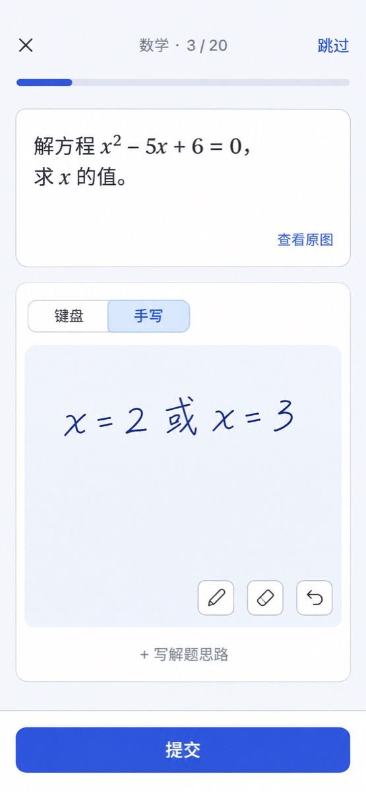
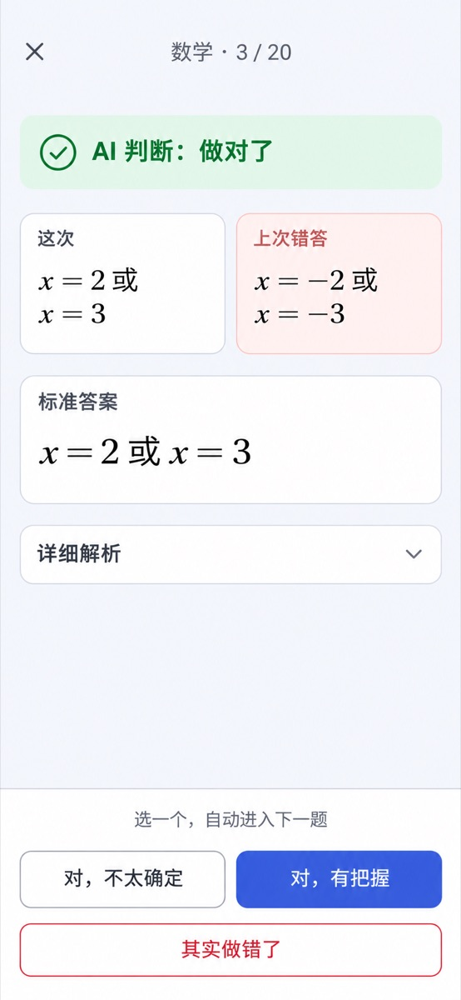

# 设计方案：复习调度与复习界面（分类间隔 · 跳档 · 按分钟的每日额度 · 专注作答）

状态：草案 v2（核心规则已与需求方确认，§11 的细节待定；新增 §14 界面改版） · 2026-11-08 · 交付形态：方案文档（本轮不写代码）

已确认决策：
- 间隔按学科**分两类**：记忆型 `1 → 3 → 7 → 15 → 30`，方法型 `3 → 7 → 21 → 45`，由学科自动判断，用户不设置。
- 作答增加「有把握 / 不太确定」：有把握跳两档，不确定升一档，做错降两档，连续两次做错清零。
- 每日额度按**分钟**计算，用户只设一个「每天复习多少分钟」，默认 30 分钟；各科题数由单题用时自动换算。
- 单题用时先用学科默认值，再按该用户该科的实际作答用时（中位数）自动校准。
- 到期日是一个**窗口**，落到窗口内已排分钟数最少的一天，避免同批录入的题同日到期。
- 超出额度的到期题**不展示**，自动顺延；积压严重时只做轻提示。
- 走完最后一档后退出日常复习；变式题复习、考前冲刺放到后期。
- 复习界面改为「一张卡片 + 一个按钮」的首页、专注作答、判题后一步确认（§14）；与调度无关的界面改动先行实施（§12 第零期）。

关联代码：`src/lib/review-schedule.ts`、`src/lib/review-due.ts`、`src/lib/review-session.ts`、`src/app/api/practice/record/route.ts`、`src/app/api/review/due/route.ts`、`src/components/review/`、`src/lib/tags/knowledge-tags.ts`（`inferSubjectFromName`）

关联文档：`README.md`、`README.en.md`、`doc/wiki/Practice-and-Exams.md`、`doc/wiki/en/Practice-and-Exams-en.md`、`doc/REVIEW_REMINDERS.md`、`doc/REVIEW_REMINDERS.en.md`

---

## 1. 现状与问题

### 1.1 现有规则

- 间隔 `[1, 2, 4, 7, 15, 30]` 天，对应录入后第 1、3、7、14、29、59 天复习。
- 档位 = 末尾连续做对的次数；做错回到第 0 档；走完 6 档后不再出现。
- **到期日不存库**：`getReviewPlan` 每次从该题全部 `correct` / `wrong` 作答记录推算。记录来源包括复习、举一反三、试卷和手动录入。
- 「今日复习」列出全部到期题，按最早到期排序。开始复习时选 10 / 20 / 全部题（`ReviewLimit`），没有按天的上限。
- `ReviewSchedule` 表存在，并参与备份导入导出，但调度逻辑没有使用它。

### 1.2 问题

| 问题 | 表现 |
| --- | --- |
| 扎堆 | 同一次考试录入的一批题，只要都做对，就会一直在同一天到期，形成峰谷 |
| 积压 | 漏做几天后，到期题全部堆到今天；量越大越不想做 |
| 次数多 | 每题至少连续做对 6 次，有做错时平均约 8 次。每周 20 道数学错题、每次 4 分钟，约等于每天 90 分钟 |
| 前期过密 | 方法型题目在第 1、3 天重做时，学生往往还记得答案，做对不代表掌握 |
| 不分难易 | 粗心题和完全不会的题需要同样的复习次数 |
| 不分学科 | 数学一题约 4 分钟、英语约 1 分钟，按题数限量无法兼顾 |

## 2. 目标与非目标

目标：
- 每道题需要的复习次数随掌握情况自动增减，平均次数明显下降（目标约 3–4 次）。
- 每天的复习量稳定在用户设定的时长附近，不出现大起大落。
- 用户只需理解一个设置项（每天多少分钟），其余由系统自动完成。
- 已有错题平滑迁移，上线当天不会集中到期一大批题。

非目标：
- 不引入 SM-2、FSRS 等需要记忆参数拟合的算法。规则要能用一张表向学生、家长解释清楚。
- 不改变现有「掌握度评估」（`masteryProbability`、`masteryLevel`）的计算方式，二者关系见 §11。
- 本期不做按科目的比例或配额设置。

## 3. 题目分类与间隔

### 3.1 两类间隔

| 类型 | 适用学科（`subjectKey`） | 各档间隔（天） | 复习日（距录入，全做对时） |
| --- | --- | --- | --- |
| 记忆型 `memory` | `english`；`chinese` 中的字词、默写 | 1, 3, 7, 15, 30 | 第 1, 4, 11, 26, 56 天 |
| 方法型 `method` | `math`、`physics`、`chemistry`、`biology` 及其余学科 | 3, 7, 21, 45 | 第 3, 10, 31, 76 天 |

判断规则：
1. 取科目的 `subjectKey`；为空时按 `inferSubjectFromName(subject.name)` 推断。
2. `english` → 记忆型。
3. `chinese`：题型（`questionType`）属于字词、默写、古诗文背诵类时为记忆型，其余为方法型。具体题型取值在实现时对照 `src/lib/question/question-type.ts` 确定。
4. 其余学科、未识别学科、无科目 → 方法型。方法型复习次数更少，作为保守默认值。

类型在每次排程时按当前科目和题型计算，不存库。题目换科目后，下次排程自动使用新类型，当前档位超出新类型的档数时按「已完成」处理。

间隔表集中定义在 `src/lib/review-schedule.ts`，便于调整。

### 3.2 到期窗口

到期日不是固定一天，而是一个窗口，用于分散负载（选日规则见 §6.4）：

| 间隔 | 窗口（天） |
| --- | --- |
| 1 | 1（不浮动） |
| 3 | 3–4 |
| 7 | 6–8 |
| 15 | 13–17 |
| 21 | 18–24 |
| 30 | 26–34 |
| 45 | 40–50 |

窗口约为间隔的 ±10%–15%，短间隔只向后浮动，保证不早于原定间隔太多。

## 4. 档位规则

### 4.1 档位含义

档位 `k`（从 0 开始）表示「下一次复习使用第 `k` 个间隔」。

- 新录入的题：`k = 0`，到期日 = 录入日 + 窗口(`间隔[0]`)。
- `k ≥ 该类型的档数` 时为「复习完成」，退出日常复习。

### 4.2 作答后的档位变化

| 作答结果 | 新档位 |
| --- | --- |
| 做对 · 有把握 | `k + 2` |
| 做对 · 不太确定 | `k + 1` |
| 做错，且上一次作答不是做错 | `max(0, k − 2)` |
| 连续第二次做错 | `0` |

新到期日 = 作答日 + 窗口(`间隔[新档位]`)。「提前复习」时起算日改为原定到期日，见 §7.3。

示例（方法型）：

| 情况 | 过程 | 复习次数 |
| --- | --- | --- |
| 粗心题 | 第 3 天有把握做对 → 跳到 21 天档；再有把握做对 → 完成 | 2 |
| 半会题 | 不确定 → 7 天档；不确定 → 21 天档；不确定 → 45 天档；不确定 → 完成 | 4 |
| 难题 | 不确定 → 7 天档；做错 → 回到 3 天档；做错 → 清零；之后再正常爬升 | 6 次以上 |

### 4.3 「有把握 / 不太确定」怎么来

- 复习页做对时显示两个按钮：「做对了，有把握」和「做对了，不太确定」。
- AI 自动判题只能判断对错。判为做对时，默认按「不太确定」处理，学生可以改选「有把握」。不点就按不确定，避免默认值导致过度跳档。
- 复习页以外的作答记录（举一反三、试卷、手动录入）没有这项信息，一律按「不太确定」处理。
- 记录在 `PracticeRecord.confidence`（§8.1）。

### 4.4 手动调整

错题详情页提供两个操作：
- **标记复习完成**：档位设为该类型档数，退出日常复习。
- **重新加入复习**：档位设为 0，到期日设为明天。

手动操作只改调度状态，不写作答记录，不影响掌握度评估。

## 5. 单题用时估计

### 5.1 学科默认值

| 学科 | 默认单题用时 |
| --- | --- |
| 数学、物理、化学 | 4 分钟 |
| 生物、地理、历史、政治、语文 | 2 分钟 |
| 英语 | 1 分钟 |
| 未识别学科 | 2 分钟 |

### 5.2 自动校准

- 复习页记录每道题的作答时长：题目显示时开始计时，提交结果时结束；页面切到后台（`visibilitychange` 为 hidden）时暂停。写入 `PracticeRecord.durationSec`。
- 校准值 = 该用户该科最近 20 条有效时长的**中位数**。有效时长为 10 秒到 30 分钟；有效样本少于 5 条时使用默认值。
- 只按科目校准，不按单题。单题样本太少，估计不稳定。
- 校准值在排程时实时计算，不存库。

## 6. 每日队列

### 6.1 额度

- 用户设置 `reviewDailyMinutes`，默认 30，范围 10–180，步长 5。位置：「设置 → 通用 → 复习」。
- 今日剩余额度 = 额度 − 今天已复习题目的估计用时之和。用估计用时而不是实际用时，避免某题做得慢就挤掉后面的题。
- 剩余额度 ≤ 0 时，今日复习显示为完成。

### 6.2 到期与优先级

到期题：`nextReviewAt` 不晚于今天结束（应用时区），且未复习完成。

排序键依次为：
1. 档位从低到高：新错的题最容易忘，不能往后拖。
2. 逾期比例从高到低：`(今天 − 到期日) ÷ 当前间隔`。高档位题晚几天影响较小。
3. 到期日从早到晚。
4. 题目 id，保证顺序稳定。

### 6.3 出题

1. 按 §6.2 排序后，按科目分组，组内保持顺序。
2. 各科轮流取题，每轮每科取一道，直到累计估计用时达到剩余额度。
3. 下一道题会超出额度时停止；但当天第一道题总是放行，不会出现「今天 0 题」。
4. 没有排进今天的到期题不展示，留到之后的日子，档位不变。

队列在每次打开复习页时实时计算。已开始的复习会话沿用现有的快照逻辑（`createReviewSnapshot`），会话中途不改变队列。

现有的 10 / 20 / 全部选择改为按额度出题，「再来一组」替代「全部」（§7.2）。

### 6.4 窗口选日（负载均衡）

作答后计算新到期日时：
1. 按 §3.2 得到候选日期。
2. 查询该用户每个候选日已排的估计分钟数（`nextReviewAt` 落在该日、未完成的题，按 §5 的用时求和）。
3. 选分钟数最少的一天；并列时按 `hash(题目 id, 档位)` 选择，保证结果确定，同一批题自然散开。

每次作答只增加一次按日聚合查询，按 `(userId, nextReviewAt)` 索引完成。

## 7. 积压与提前复习

### 7.1 积压提示

- 积压 = 已到期但未排进今天队列的题。
- 积压题的估计总时长超过 3 天额度时，在复习页顶部轻提示一次：「有些题已经往后排了，想多做一点可以点“再来一组”。」
- 不显示积压题数，不弹窗，不进入推送提醒。

### 7.2 再来一组

今日队列完成后，显示「再来一组」，每组约 15 分钟：
1. 有积压时，先按 §6.2 的顺序取积压题。
2. 没有积压时，从未来 3 天内到期、档位 ≥ 2 的题中取，即提前复习。

### 7.3 提前复习的起算日

提前复习后，新到期日从**原定到期日**起算，而不是从作答日。避免因为提前做，间隔反而变短。做错时仍按作答日起算。

## 8. 数据模型

### 8.1 字段变更

`ErrorItem`：

| 字段 | 类型 | 说明 |
| --- | --- | --- |
| `reviewStage` | `Int @default(0)` | 当前档位 |
| `nextReviewAt` | `DateTime?` | 下次复习日（应用时区当天零点）；复习完成时为空 |
| `reviewCompletedAt` | `DateTime?` | 复习完成时间；为空表示仍在复习中 |
| `reviewWrongStreak` | `Int @default(0)` | 连续做错次数，用于判断「连续第二次做错」 |

新增索引 `@@index([userId, nextReviewAt])`。

`PracticeRecord`：

| 字段 | 类型 | 说明 |
| --- | --- | --- |
| `confidence` | `String?` | `sure` / `unsure`；为空按 `unsure` 处理 |
| `durationSec` | `Int?` | 作答时长（秒）；只有复习页会写入 |

`User`：

| 字段 | 类型 | 说明 |
| --- | --- | --- |
| `reviewDailyMinutes` | `Int @default(30)` | 每天复习分钟数 |

所有新字段都可空或有默认值，旧程序可以忽略，满足 `PRESERVE_EXISTING_DATA=true` 下只走迁移的要求。

### 8.2 调度状态的来源

调度状态以 `ErrorItem` 上的字段为准，不再每次从作答记录推算。原因是负载均衡需要知道每天已排多少题，而且选日结果依赖当时的负载，无法从历史记录唯一还原。

保留一个重建函数 `rebuildReviewState(item, records)`：按时间顺序重放作答记录，得到档位和连续做错次数，再按 §6.4 选日。它用于迁移、导入旧备份，以及字段缺失时的兜底。

作答记录写入（`/api/practice/record`）和调度状态更新在同一个事务中完成。删除作答记录时用重建函数重算该题的状态。

### 8.3 遗留的 `ReviewSchedule` 表

本方案不使用该表。导入导出保持现状，避免影响旧备份；是否删除另行决定。

## 9. 迁移已有错题

迁移在正式数据库迁移后执行一次性回填（幂等，可重复运行）：

1. 对每道题取现有档位 `c`，即末尾连续做对次数，范围 0–6。
2. 按比例折算到新档位：`k = round(c × 新类型档数 ÷ 6)`；`c = 6` 为复习完成。

   | 旧档位 c | 0 | 1 | 2 | 3 | 4 | 5 | 6 |
   | --- | --- | --- | --- | --- | --- | --- | --- |
   | 方法型（4 档） | 0 | 1 | 1 | 2 | 3 | 3 | 完成 |
   | 记忆型（5 档） | 0 | 1 | 2 | 3 | 3 | 4 | 完成 |

3. `reviewWrongStreak` = 末尾连续做错次数。
4. 新到期日 = 最后一次作答日（没有作答时为录入日）+ 窗口(`间隔[k]`)，按 §6.4 选日。已经过期的题保持过期，进入每日额度排队，不会一次全部展示。
5. 旧作答记录的 `confidence`、`durationSec` 保持为空。

回填按用户分批进行，同一用户内按到期日顺序处理，使负载均衡能看到前面已排的题。

## 10. 关联改动

### 10.1 接口

- `GET /api/review/due`：返回今日队列，以及 `budgetMinutes`、`plannedMinutes`、`consumedMinutes`、`showBacklogHint`。不再返回积压题总数。
- 新增「再来一组」接口（或在 `due` 上加参数），按 §7.2 取题。
- `POST /api/practice/record`：接受 `confidence`、`durationSec`，返回更新后的档位和到期日（替代现在的 `reviewPlan`）。
- 错题详情的两个手动操作（§4.4）。

### 10.2 复习提醒

`getDueReviewSummary` 改为统计今日队列，而不是全部到期题。推送中的「待复习 N 题」与复习页看到的一致，并可附带「约 X 分钟」。同步更新 `doc/REVIEW_REMINDERS.md` 与英文版。

### 10.3 导入导出

- `BACKUP_VERSION` 16 → 17。
- 导出新增 §8.1 的字段。
- 导入版本 ≤ 16 的备份时，缺少调度字段，用 `rebuildReviewState` 重建；缺少 `reviewDailyMinutes` 时用默认值。
- `data-backup.test.ts` 覆盖新旧两种格式的往返。

### 10.4 界面

复习首页、作答页和小结页的改版见 §14。其余位置：
- 设置页：「每天复习多少分钟」。
- 错题详情：显示当前档位、下次复习日，以及两个手动操作（§4.4）。
- 文案按 `src/lib/i18n/zh.ts`、`en.ts` 同步添加。

### 10.5 文档

`README.md`、`README.en.md`、`doc/wiki/Practice-and-Exams.md` 及英文页现在写着 `1、2、4、7、15、30` 天的规则，需同步改为新规则。界面文案 `src/lib/i18n/` 中的同一说明也要改。

## 11. 待定事项

| # | 问题 | 当前倾向 |
| --- | --- | --- |
| 1 | 「复习完成」与现有掌握度评估（`masteryProbability`、`masteryLevel`、用户的 `masteryThreshold`）是什么关系 | 两者独立。调度只看自己的档位；界面上把调度完成称为「复习完成」，「已掌握」仍指掌握度评估，避免出现两套「已掌握」 |
| 2 | 语文中哪些题型算记忆型 | 实现时对照 `QUESTION_TYPES` 列出清单再确认 |
| 3 | 默认 30 分钟是否合适，是否按学段区分（如小学 20、高中 40） | 先统一 30 分钟，上线后看实际使用情况 |
| 4 | 是否删除遗留的 `ReviewSchedule` 表 | 本期不动 |
| 5 | 「本周重点科目」（轮流取题时该科每轮取两道） | 放到第三期，视需求再定 |

## 12. 分期计划

每期可独立上线、独立回退，按 `AGENTS.md` 的约定拆分提交。

### 第零期：界面先行（不依赖调度改动）

- 作答页专注模式：隐藏应用顶栏和底部导航，单行顶栏与进度条（§14.4）。
- 作答区精简：去掉空白标题区与输入说明，「写解题思路」默认收起，手机端「提交」固定在底部（§14.4）。
- 判题后：结果条、「这次 / 上次错答」并排、解析折叠；对 / 错按钮点一次即保存并进入下一题，带撤销（§14.5，暂不含「有把握 / 不太确定」）。
- 首页：去掉规则说明与题卡上重复的状态标签；没有到期题时不显示题量和开始按钮；题目列表改为紧凑列表（§14.3 中不依赖分钟额度的部分）。
- 列表页与作答页使用一致的页面宽度和边距。

### 第一期：新档位规则

- 数据迁移：`ErrorItem` 调度字段、`PracticeRecord.confidence`。
- 两类间隔（§3.1）、档位规则（§4.2）、「有把握 / 不太确定」（§4.3）。
- 窗口选日先只用哈希，不感知负载。
- 判题后的确认按钮扩展为三个（§14.5）。
- 存量回填（§9）、重建函数、导入导出（§10.3）。
- 手动调整（§4.4）。
- 每日出题暂时沿用现有的 10 / 20 / 全部。

### 第二期：按分钟的每日额度

- `PracticeRecord.durationSec` 与复习页计时，单题用时校准（§5）。
- `User.reviewDailyMinutes` 与设置页。
- 优先级、各科轮流出题、积压不展示与提示、再来一组、提前复习（§6、§7）。
- 窗口选日改为按负载（§6.4）。
- 首页的分钟额度卡片、完成状态与「再来一组」（§14.3、§14.6）。
- 复习提醒统计口径（§10.2）。

### 第三期：效果增强

- 方法型第 3、4 档优先出变式题（复用举一反三）；生成失败或学生选择时回退到原题。可配置开关，避免 AI 调用量失控。
- 考前冲刺：按科目、知识点、时间范围，重新复习已完成的题。
- 本周重点科目。

## 13. 测试要点

单元测试（`review-schedule.test.ts` 等）：
- 两类间隔的判断，包括语文按题型区分、未识别学科的默认值。
- 档位变化的每种组合：有把握、不确定、做错、连续做错，以及边界（第 0 档做错、最后一档跳两档直接完成）。
- 窗口选日：负载最小、并列时哈希结果确定。
- 用时校准：样本不足、异常值过滤、中位数计算。
- 出题：额度截断、各科轮流、第一题放行、优先级排序、已复习题扣减额度。
- 提前复习从原定到期日起算。
- 迁移折算表（§9）。

集成测试：
- 作答记录写入与调度状态在同一事务中更新；删除作答记录后重算。
- `/api/review/due` 的队列与额度字段。
- 旧版本备份导入后重建调度状态；新版本往返不丢字段。
- 复习提醒的数量与复习页一致。

## 14. 复习界面改版

### 14.1 现状问题

依据 2026-11-08 对线上版本 `2026.11.8-1` 的截图（电脑端 1280×900、手机端 390×844，测试账号与临时题目）：

| 位置 | 问题 |
| --- | --- |
| 首页 | 主操作「开始复习」与题量下拉框挤在右上角；标题下是一段间隔规则说明，调度改版后会过时，学生也不需要 |
| 首页 | 题卡同时显示「复习中」和「做错了」两个状态标签，含义重复 |
| 首页 | 「第 1 / 6 轮」和「举一反三」放在卡片外；卡片高度不同时这一行对不齐 |
| 首页 | 没有到期题时，题量下拉框和「开始复习」仍然显示 |
| 首页 | 全部到期题以大卡片网格平铺、分页，与「先开始复习」的主流程争夺注意力 |
| 作答页 | 题目前有「返回复习列表」「复习会话」大标题、「第 1 / 2 题」三行；手机上题目从屏幕约三分之一处才开始 |
| 作答页 | 「重做原题 / 举一反三」切换放在每题最上方，但绝大多数情况只用原题 |
| 作答页 | 作答卡片顶部有空白区，另有一行输入方式说明；「解题思路（可选）」输入框常驻 |
| 作答页 | 手机上底部导航栏仍然显示并遮挡作答区，「提交答案」在首屏以下 |
| 作答页 | 电脑端题目卡片下方大面积空白；作答页宽度约 1600px，与列表页约 1150px 不一致，左边距跳动 |
| 判题后 | 「回答正确」→ 参考答案、解析、原错答、你的答案纵向平铺 →「这道题做得怎么样？」（AI 已预选）→「保存结果」→「下一题」，提交后还要点两次 |
| 判题后 | 最值得对比的「原错答」和「你的答案」上下隔开 |

### 14.2 设计原则

- **一屏一件事**：首页只做「开始」，作答页只做「作答」，判题后只做「确认」。
- **少做决定**：开始前不需要选题量；科目筛选是次要入口。
- **拇指可达**：手机上主按钮固定在屏幕底部。
- **不讲规则**：界面不出现间隔天数、档位、轮次等内部概念，只说「今天约多久」「下次什么时候」。
- 沿用现有的 shadcn 组件与配色，不引入新的视觉风格。

### 14.3 复习首页

- 标题「今日复习」，不显示说明文字。
- 主卡片：大字「约 X 分钟」，旁边小字「N 题」；下面每科一行「科目 · N 题 · 约 X 分钟」，科目前有色点。第零期没有分钟额度时，只显示题数和各科题数。
- 主卡片下方一个满宽主按钮「开始复习」。
- 次要入口「只复习某一科」，下面是科目小标签（替代原生下拉框）。点标签直接按该科开始复习。
- 底部一行：左边「明天约 X 分钟」（第二期），右边「查看今日题目」。展开后是紧凑列表，每行显示题干摘要和科目，点击进入错题详情；不再使用大卡片网格和分页。
- 去掉题量下拉框。第零期保留现有的 20 题默认值，超过 20 题时在列表中注明；第二期由分钟额度替代。
- 每道题的「举一反三」入口移到错题详情页，首页不再放。
- 状态：
  - 有到期题：如上。
  - 今天的题已做完：主卡片显示「今天的复习完成了」和本次用时，主按钮变为「再来一组」（第二期；第零期不显示按钮）。
  - 本来就没有到期题：显示空状态，不显示开始按钮和题量选择；可附「明天约 X 分钟」。

### 14.4 作答页（专注模式）

- 隐藏应用顶栏和底部导航。
- 顶栏一行：左侧关闭（×，返回首页并保留当前进度提示）、中间「科目 · 当前 / 总数」、右侧「跳过」；下面一条细进度条。去掉「返回复习列表」链接和「复习会话」标题。
- 题目卡片：题干与配图；「查看原图」作为卡片右下角的小链接。
- 作答卡片：顶部是「键盘 | 手写」分段切换，去掉空白标题区和说明文字；手写画布占满剩余高度，笔、橡皮、撤销等工具放在画布角落。
- 「+ 写解题思路」默认收起，点击后展开输入框。
- 「提交」：手机端固定在屏幕底部（考虑 `safe-area-inset-bottom`），电脑端跟在作答卡片下方。没有作答内容时按钮保持可点，点击后提示先作答，而不是显示为浅色禁用态。
- 「举一反三」不再作为每题顶部的切换按钮，改为判题后的次要操作「换一道类似题」；调度第三期改为自动出变式题（§12）。
- 离开前确认：已有作答内容时点关闭，提示是否放弃本题作答。

### 14.5 判题后（一步确认）

- 顶栏同 §14.4，不显示「跳过」。
- 结果条：AI 判对为浅绿色「AI 判断：做对了」，判错为浅红色「AI 判断：做错了」，判题失败为中性色「请自己核对答案」。AI 判断依据作为结果条下的一行小字，可展开。
- 对比区：「这次」与「上次错答」左右并排（手机宽度不足以并排时上下排列，但紧挨在一起），上次错答用浅红色底。只有手写作答时，「这次」显示笔迹缩略图。
- 「标准答案」单独一张卡片；「详细解析」默认折叠。
- 底部固定确认区，提示「选一个，自动进入下一题」：
  - 第零期：「做对了」「做错了」两个按钮。
  - 第一期起：「对，不太确定」「对，有把握」「其实做错了」三个按钮（§4.3）。
  - AI 判对时「对，有把握」为主按钮；AI 判错时「做错了」为主按钮；判题失败时没有主按钮。
- 点击即保存并进入下一题，屏幕底部显示约 5 秒的「已记录为…  撤销」提示。撤销会删除刚写入的作答记录、恢复调度状态，并回到上一题的判题后界面。
- 保存失败时停留在当前题，按钮恢复可点，显示错误提示。
- 去掉原来的「保存结果」和「下一题」两个独立按钮。
- 次要操作「换一道类似题」放在解析下方的文字链接。

### 14.6 小结页

- 三个数字（做对、做错、跳过）加本次用时。
- 题目列表沿用现有内容：题干摘要、结果、下次复习日。
- 两个按钮：「再来一组」（第二期）和「返回首页」。

### 14.7 电脑端与 iPad

- 列表页与作答页使用同一个页面最大宽度和左右边距。
- 作答页在宽屏上保留「左题目、右作答」两栏；题目栏高度随内容，不再拉伸成大块空白；提交按钮跟在作答栏下方。
- 判题后的对比区在宽屏上与标准答案并排成三列或两列，确认按钮放在内容下方，不固定在屏幕底部。
- iPad 横屏按宽屏处理；竖屏按手机布局处理，手写画布占满宽度。

### 14.8 涉及的代码

| 文件 | 改动 |
| --- | --- |
| `src/app/review/page.tsx` | 首页结构（§14.3），抽出主卡片、科目标签和紧凑列表组件 |
| `src/app/review/session/page.tsx`、`src/components/review/review-session.tsx` | 专注模式顶栏、隐藏全局导航、去掉会话内的开始前设置 |
| `src/components/review/review-question.tsx` | 去掉原题 / 举一反三切换，改为判题后的次要入口 |
| `src/components/review/original-review.tsx` | 作答区精简、判题后布局、一步确认 |
| `src/components/practice-result-card.tsx` | 复习场景改用一步确认（其他场景保持不变） |
| `src/components/review/review-summary.tsx` | 用时与「再来一组」 |
| `src/components/review/review-limit-select.tsx`、`review-subject-filter.tsx` | 题量选择移除；科目筛选改为标签 |
| 应用布局与底部导航 | 提供在复习作答页隐藏全局导航的方式 |
| `src/lib/i18n/zh.ts`、`en.ts` | 新增与删除的文案，删除 `review.desc` 中的间隔规则说明 |

### 14.9 验收要点

- 手机 390×844：首屏能同时看到题目、作答区开头和固定的「提交」；判题后不滚动即可点到确认按钮。
- 一道题从作答到进入下一题：提交 1 次 + 确认 1 次。
- 撤销能恢复上一题的作答记录与调度状态。
- 没有到期题时，首页不显示开始按钮。
- 电脑端列表页与作答页左边距一致。
- 现有 E2E（`e2e/review.spec.ts`）中依赖旧文案和结构的断言随改版更新，并补充一步确认、撤销与空状态的用例。

效果图由 Codex 图片生成功能绘制，只表达布局与层级；应用图标、具体颜色和组件细节以现有实现为准。
