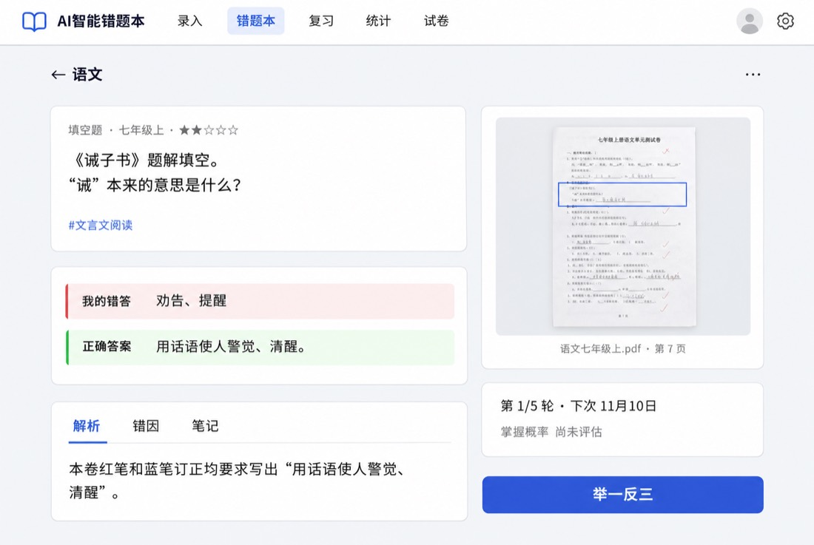

# 错题管理指南

学生端两种风格统一使用 **今天（`/`）/ 错题本（`/notebooks`）/ 收集册（`/collection`）/ 我的（`/me`）**。宽度 ≥768px 为 88px 左侧栏，含头像与聚焦今天图片录入区的拍照入口；头像在会话加载中显示同尺寸空圆，加载完成后显示用户首字，无名称时才使用后备字；手机为四标签底栏，预留安全区，无浮动按钮。“我的”学习分组提供做题记录、学习统计、试卷和「上传记录」；设置分组统一行样式，包含界面风格、明暗主题、设置、AI 助手接入，末尾为后台任务面板；另有管理（仅管理员）与退出；退出前清空本机待上传队列和录入草稿。今天显示识别进度、失败及可查看结果；收集册展示真实知识点贴纸，支持三态筛选与针对性练习。复习会话（`/review/session`）与核对页（`/checks`）从加载起默认隐藏全局导航，仅空队列或无可作答内容的错误恢复外壳；已有卡片的保存错误保持专注，复习收工小结也保持专注并自带返回出口；题目详情保留底栏，操作按钮位于其上方。

核对空队列只保留「回今天」主按钮；从同源错题本或题目详情进入且有可返回历史时改为「返回」。直接打开无题目参数的 `/practice` 会替换跳转到 `/notebooks`，不显示提示卡。上传任务卡片的各阶段技术耗时仅管理员可见，默认折叠在「详情」中。

今天页（`/`）先展示应用时区日期、问候与预计分钟，再按科目列出今日复习题数和用时。科目行用「已复习/应复习」数字显示只读进度，应复习数为今日已复习题数加当前额度队列剩余题数；有当日复习记录且该科已无剩余题时显示对勾与「完成」。点击尚有剩余题的科目整行进入单科复习。首页与 `/review` 共用概览数据源。≥1024px 左任务右清单、状态、周贴纸与录入；768–1023px 单栏按任务、状态、清单、周贴纸、录入排序。平板默认展开前 6 题，手机仅在清单折叠卡保留「看看是哪 n 题」入口，默认折叠，可查看全部并渲染公式。识别与核对提示共用一张白纸卡，无内容时隐藏。加载用骨架，失败可重试，不显示假零。录入放在最后的「又错了新题？」中，触屏显示「拍照 / 相册 / 文件 / 打字」一排入口，拍照直接打开相机；桌面显示共用拖放区与打字按钮，下方小号链接打开 AI 助手接入设置。切换入口保留上传队列、草稿恢复、确认流程与 `?notebook=` 目标。文字入口提示「把题目贴过来」，格式帮助默认折叠。贴纸奖励与连续复习天数来自只读进度服务。

## 创建错题本

创建错题本时选择学段（小学、初中或高中）和学科。学段与学科决定 AI 使用的知识点库，创建后不可修改，建议按学习阶段和学科分别管理。

小学可选数学、英语和语文。内置语文库覆盖小学一年级至六年级及初高中各年级的章节与知识点。升级 Docker 或安装包后，启动时会自动补齐缺失的内置语文标签，并保留旧标签 ID、题目关联、自定义标签和其他标签体系。

管理员导入「人教版课标体系」知识点后（见 [设置与用户管理](Settings-and-Users)），创建错题本时会多出「标签体系」选项。该体系与内置体系并存，创建后不可更改，AI 识别和知识点筛选只使用错题本所选体系的标签。

点击错题本封面进入列表；重命名和删除都在详情页进行。只能删除已清空的错题本，删除前先移走或删除其中的错题。

错题本页以科目色封面显示总题数、掌握进度和今日复习数，简洁风格保留结构并去掉纸张装饰。搜索支持题目、知识点与 6 位题号，输入题号后回车可精确定位；手机提示简写为「搜题目或题号」。≥1024px 左侧为 320px 选本栏，右侧显示所选本列表；未选本时提示选择，当前本子以描边高亮。手机与竖屏先选本，再跳转列表。列表头显示总数、已掌握与还没掌握数量，胶囊标签页带数量；「复习这本」仅进入全局今日额度队列中属于该本的题，数量为 0 时隐藏；iPad 上与添加、更多同行，手机上为标题与统计下方的全宽入口，统计各段保持完整、段间可换行。列表当前页按导入日期与出处文件名分组（同文件同一天为一组）；没有文件名时沿用来源首段。预览省略同组重复的开头说明，显示题目自身内容、首个知识点、掌握状态、「今天」标记与错过次数或下次复习日期。「今天」标记与今天页额度队列一致，队列内不重复显示下次日期；按应用时区已到期（含过期）但未排入额度的题显示弱化的「排队中」，提示「今天的复习时长已排满，之后会轮到」，不显示日期；未到期题保留「下次」日期。仅有可渲染 SVG 配图时显示配图缩略图，按需读取；仅有原图出处时显示回形针「原图」入口，没有出处时不显示图标。搜索框旁的筛选面板在手机从底部、桌面从右侧展开，集中年级/学期、章节、知识点、时间、卷别与题型，已生效条件可逐项移除。状态标签页与筛选面板统一为「全部 / 还没掌握 / 已掌握」，使用 `all / unmastered / mastered`；「还没掌握」包含内部 `new` 与 `reviewing`。旧 `?mastery=new`、`?mastery=reviewing` 仍按原状态精确筛选。导出打印、多选、比较相似度、重新识别、重命名和删除收进右上角「更多」；也可长按题目进入多选，底部沿用导出、比较与删除操作。手机和桌面均在标题工具区添加。列表只加载轻量字段、配图地址与原图出处标识，答案和解析仍按需读取；保留 `?mastery=unmastered|new|reviewing|mastered` 与 `?tag=标签名` 的初始筛选。

## 录入题目

相册支持一次选择最多 20 张照片：单张仍可裁剪，多张先选择「每张一道题」或「每张含多题，自动分题」：前者每张压缩后独立提交后台识别任务，后者每张创建分题批次、在预览确认后再逐题解析；结果在「识别任务」中查看，仍遵循「导入前人工确认」偏好、AI 授权与额度限制。提交后可点「继续拍下一张」直接打开相机，无需等待识别完成。已有暂存题目段落时，请先完成或放弃后再多选。

弱网时，单题、相册多选、手工框选和首页照片自动分题会先将压缩后的图片及上传参数保存到当前浏览器的待上传队列，成功提交才移除。网络失败、超时或服务器错误会保留照片并指数退避重传；联网、回到页面或手动点「重试」可继续上传。额度、AI 未授权、格式等业务错误会显示原因并停止自动重试，可处理后手动重试或删除。队列按账号隔离，退出登录（包括注销账号）会清空，仅存在本机浏览器，不随备份或换设备迁移；浏览器禁用 IndexedDB 或空间不足时退回原有直接上传，无法保证保留失败照片。已在服务器创建的任务仍从「识别任务」查看。

| 入口 | 适用情况 |
| --- | --- |
| 图片上传、拖拽、拍照 | 纸质试卷、练习册和已有题目图片 |
| 剪贴板粘贴 | 已复制的截图或图片，使用 `Ctrl/⌘+V` |
| 屏幕截图 | 浏览器支持屏幕共享，且页面满足安全上下文要求 |
| 打字 → AI 解答 | 已有文字题干，可使用 Markdown 与 LaTeX；也可点「从文件导入」选择 TXT / Markdown 文件 |
| 文件 | 已有的题库文件（JSON / Word / Excel / CSV / PDF），解析后按批次导入 |
| 打字 → 已有答案 | 手工整理已知的题干、答案和解析 |

手机和平板使用同一排「拍照 / 相册 / 文件 / 打字」入口；拍照直接打开相机，无摄像头时提示改用相册或文件。相册支持多选；通用文件选择器同时接受图片、PDF、Word、Excel、CSV、TXT / Markdown 和 JSON，图片（含无 MIME 的 HEIC/HEIF）进入裁剪，其他文件进入文件导入。桌面显示共用拖放区和打字按钮，支持拖入、Ctrl/⌘+V 粘贴或点击选择图片 / 文件；浏览器支持时，截图按钮位于拖放区内。HEIC/HEIF 会在裁剪前按真实内容解码并校正方向，无法解码或损坏时提示具体原因。

图片可以先裁剪，裁剪和多题框选时可用鼠标滚轮、触屏双指捏合或右上角的按钮缩放（100%～500%，点击比例还原）；一张图片上有多道题时，可选择「自动分题」由 AI 识别每道题（见下文「多题录入」），或「手工框选」多题批量导入。一道题分在两张（或更多）纸上时，在「单题裁剪」中框选第一段后点「下一段在另一张」，这一段会暂存在录入页上方；再拍摄或选择下一张照片，框选接着的部分，点「拼成一题并识别」，各段按顺序缩放到同一宽度、上下拼成一张图后识别。一道题最多 4 段，已暂存时也可直接点「拼成一题并识别」或「放弃已暂存的」；暂存期间裁剪只提供单题模式。裁剪预览使用缩略图，确认后从原图裁剪，输出按最长边 4096 像素、约 490 万像素和 1.5MB 共同限制，JPEG 质量不低于 0.8，以保留小字、公式和配图。尽量保留完整题干、必要图形和学生作答，避免模糊或裁掉条件。

在“设置 → 通用”开启“导入前人工确认”后，可先在校对页修改识别内容再保存。AI 可能识别错数字、符号和图形关系，保存前应核对原题。

首页与错题本添加页共用这一排入口，不再显示「更多」菜单或来源页签。下方「用 AI 助手批量导入」链接打开接入设置。「打字」提供「AI 解答」和「已有答案」两种方式。切换入口保留输入与文件摘要；文字草稿按账号、错题本保存在当前标签页，刷新后可恢复，退出登录或注销账号时清除，不进入备份。浏览器禁用会话存储时仅在当前页面保留。已有答案的录入先显示题干和答案，解析、错因、年级等资料可展开补充。

相册一次最多选择 20 张照片，随后选择「每张一道题」或「每张含多题，自动分题」。后者每张创建分题批次，需要在识别任务中打开预览并确认后再逐题解析，不会直接把整张试卷当成一道题。


文件摘要的「下一步：预览 N 题」只创建预览批次，确认导入后才入库。已选题都带答案时默认「按原样入库」；可主动选择 AI 补标签或完整解析，编辑题目、勾选和撤销不会改变已明确选择的处理方式。操作栏显示是否调用 AI，结果分别统计已入库、待校对、失败和重复。目标错题本只有一个时自动选中，也可在选择器旁直接新建错题本。

### 导入题库文件

首页和错题本内的「文件」入口可直接导入已有的题库文件，解析后按批次进入导入中心校对，可「按原样入库」（不调用 AI）。TXT / Markdown 文件自动填入文字框；在文字入口选中题库文件也会直接继续解析，无需重选。支持格式：

| 格式 | 扩展名 | 大小上限 | 说明 |
| --- | --- | --- | --- |
| JSON（题目交换格式 v1） | .json | 50MB | 应用导出的交换格式，字段最全 |
| Word | .docx | 50MB | 普通段落、自动编号、表格与行内标记 |
| Excel | .xlsx | 20MB | 自动识别表头，多工作表可用工作表名做大题 |
| CSV | .csv | 10MB | 自动识别逗号/分号/制表符与 UTF-8/UTF-16/GBK 编码 |
| PDF | .pdf | 50MB | 必须带文字层；扫描版自动转图片走 AI 识别（见下） |

- **流程**：选择文件 → 解析（显示进度）→ 图片合成（如有）→ 摘要（共 N 题、M 题出错及原因、警告、暂未导入字段）→ 选择目标错题本（必选）→ 创建批次并跳转导入中心。一次最多导入 2000 题，解析出错的题不会导入。
- **暂未导入字段**：题目交换格式中的学科、年级学期、来源、配图 SVG 与扩展字段暂不写入草稿，导入摘要会提示出现次数。
- **模板**：Excel / CSV 可在导入页下载模板（含示例数据与列名说明），列名兼容中英文。
- **暂不支持**：TIFF 等浏览器无法渲染的图片格式暂不支持导入（会以警告提示）；旧版 .doc 二进制文件需先用 Word 另存为 .docx 再导入。

JSON 题目交换格式见 [题目交换格式规范](../QUESTION_FORMAT.md)。

#### Word（.docx）写法

- **支持的写法**：普通段落、自动编号段落、表格（单元格用制表符连接）、行内【答案】【解析】【知识点】【难度】【错答】标记，以及「参考答案」答案区按题号回填。
- **自动编号**：Word 自动编号的题号不在文字里，解析器会根据 numbering.xml 计算编号文本（如「1.」「一、」「（三）」），支持 decimal、中文计数（一、二、三…）、圈码（①②③）、大小写字母与罗马数字等常见格式。
- **上标与下标**：上标输出为 `^{…}`（纯数字简写为 `^2`，如 x^2），下标输出为 `_{…}`（同规则，如 `a_{n+1}`）。
- **Word 公式**：Word 自带公式（插入 → 公式）会转为 LaTeX 供 KaTeX 渲染——行内公式输出为 `$…$`，独占一行的公式输出为 `$$…$$`；分数、根号、上下标、∑/∫/∏、方程组、矩阵等常见结构都会转换。MathType 等 OLE 公式对象（run 内直接放 `w:object`）不是 OMML：其 WMF 预览图会先尝试结构还原——简单公式（分数、上下标、常见符号如 ×÷≤≥≠π°）会转为 LaTeX 直接嵌入正文原位置（`$…$` 风格，与 OMML 一致），计数 `OLE_EQUATION_LATEX:N`；复杂公式（根号、几何图形、多条斜线等）无法可靠还原时按图片保留，正文以「[公式]」标出位置，计数 `OLE_EQUATION_IMAGE:N` 与 `METAFILE_RENDERED:N`。EMF 预览图暂不渲染，计入 `METAFILE_FAILED:N`（MathType 公式基本都是 WMF）；个别不支持的 OMML 结构会尽力保留文字并汇总到 `MATH_UNSUPPORTED:元素名` 警告中。旧版 .doc 二进制文件需先用 Word 另存为 .docx 再导入。
- **图片**：Word 内嵌图片（w:drawing 与 w:pict）会作为题目原图导入——正文、答案、解析中的图片按出现顺序归属对应题目，多张图纵向拼成一张并压缩到长边 ≤ 1600、约 ≤ 1MB。MathType/公式编辑器等 OLE 公式对象的 WMF 预览图会在导入时渲染为位图保留在题目原图中（文字中以「[图片]」标出公式位置；渲染结果计数见导入摘要 `METAFILE_RENDERED:N`，失败计数 `METAFILE_FAILED:N`——EMF 预览图暂不渲染也计入失败；单题拼接的公式小图超过 12 张时超出部分不再拼接，计数 `METAFILE_TRUNCATED:N`）。TIFF 等浏览器无法渲染的格式暂不支持（导入警告中会计数 `IMAGE_UNSUPPORTED:格式`），正文中以「[图片]」占位提示。
- **删除线与隐藏文字**：解析时跳过；修订内容保留插入、跳过删除。
- **PDF 文字层**：PDF 必须带有文字层（由 Word 或生成工具嵌入文字，在阅读器中能选中复制）。双栏排版会先读左栏再读右栏；每页重复出现的页眉页脚（含页码差异，如「第 3 页」「- 3 -」）会自动移除。扫描版 PDF 没有文字层，无法直接提取文字；导入时会提示「这是扫描版 PDF」，可选择页码范围（单次最多 20 页）转为图片，由 AI 识别并自动分题，每页消耗一次 AI 分题额度。带文字层但个别页空白的 PDF 会按文字层正常导入，并在警告中提示空白页数。加密 PDF 暂不支持。
- **PDF 题目原图**：导入带文字层的 PDF 时，默认给每道题按版面区域截图，保存为题目原图，便于查看原题样子（公式、图形、表格不受文字层乱码影响）。摘要页「题目原图」可改为「有图形的题」（仅给检测到图片、几何图形、函数图像、表格线等元素的题截图；PDF 中没有图形时不可选）或「不保存」。题目跨栏或跨页时分段裁剪后纵向拼接，压缩到长边 ≤ 1600、约 ≤ 1MB；题目文字仍照常导入。
- **带原图题用 AI 完整解析时按图片识别**：题目带原图（PDF 截图或 Word 内嵌图片合成）时，选择「AI 完整解析」会按图片识别，文件中的文字层仅作为参考附给模型（文字层中公式、排版容易乱码或缺字，以图片为准）；这些题按图片识别计额度。选择「AI 只补知识点和难度」或「按原样入库」时不调用完整识别，不受此影响。

#### Excel / CSV 列名说明

见下文「Excel / CSV 题库模板」。

### 多题录入

一次录入多道题时不必逐题粘贴或逐张裁剪：

- **文字**：在「文字 → AI 解答」中粘贴整份练习，输入框下方会实时提示「检测到 N 道编号题」（本地按题号识别，不调用 AI）。点「分题预览」进入预览；只想当作一道题时点「作为一道题解析」。已有文字题干的 TXT / Markdown 文件（最大 2MB）可点输入框右上角的「从文件导入」直接填入，自动识别 UTF-8 / UTF-16 / GBK 等常见编码；文字框已有内容时会询问替换还是追加到末尾。选项（A～D）、小问（(1)(2)、①②）留在所属题内；阅读材料作为公共材料拼在相关题目前；标题、姓名/日期栏、「共 N 道」等说明不计入题目，可在「未计入题目的内容」中找回。分组标题（如「兴趣篇」「拓展篇」「一、选择题」）后题号重新从 1 开始也能正确分题，各段题目会带上对应的分组标题。题干后紧跟 1) 2) 或「回答下列问题：」这类编号时，可能是同一道题的小问，默认按一道题处理，确需拆开时点「仍按 N 题分题预览」。每批最多 60 题；文字超过 20000 字或本地分题结果超过 60 题时，会自动拆成多个批次（每批最多 60 题），界面提示「已拆成 N 个批次」，每个批次在「识别任务」中独立显示。没有题号的多道题可点「用 AI 分题」，会调用一次 AI 找出题目边界，题目文字始终取自你粘贴的原文；题号有误（如 OCR 把题号认错）导致本地分错时，检测提示下方也有「分得不对？用 AI 分题」。
- **照片**：选择照片后在裁剪窗口切换到「自动分题」，可先框出试卷区域（默认整张），点「自动识别题目」。需要 AI 模型支持图片输入。照片上传后识别在服务器上进行，可以离开页面。模型给不出可靠位置的题标为「未定位」，默认不选，需要在原图上框选；照片模糊或只拍到部分时会提示核对。仍可使用「单题裁剪」和「手工框选」。

网页照片和扫描版 PDF 入库后会保留上传的整页原图以便追溯。同一页多题按图片哈希共享出处页，框选位置采用入库时的草稿；单张照片以任务中压缩后的照片作为出处，区域为整页。扫描 PDF 保留渲染页以及文件名、页码；没有可用位置时采用整页区域。重复题沿用原出处，失败后重试不会重复创建位置记录。纯文字、表格和 Word 文本不创建出处页。

**答案解析标记**：题目内部以行首标记写出的参考答案、解析、知识点、难度和错答会自动识别并填到草稿的对应字段（不再混在题干里），解析时作为参考附给 AI。支持的标记写法：`【答案】`/`答案：`/`【参考答案】`/`Answer:`（答案）、`【解析】`/`解析：`/`【分析】`/`【详解】`/`【解答】`/`【点评】`（解析，多个标记分段落合并）、`【知识点】`/`知识点：`/`【考点】`/`考点：`（按顿号、逗号、分号分隔）、`【难度】`/`难度：`（支持 1～5 数字、★ 个数或「易/较易/中等/较难/难」）、`【错答】`/`我的答案：`/`学生答案：`（学生的错误作答）。冒号兼容中英文，括号兼容全角半角。整卷末尾的「参考答案/答案与解析」区块中，按题号列出的条目（如「1. B」「2．答案：12 解析：……」）会自动回填到对应题目的答案与解析；匹配不上的条目仍列入「未计入题目的内容」。在分题预览中展开一题即可查看并修改这些字段。

预览页显示「识别出 N 题 · 已选 N 题」。每道题默认折叠，点开后可编辑、在光标处拆分、与上一题合并、上下移动或删除，顶部可全选和撤销。照片题可在原图上看到编号框，点「调整区域」重新框选（一题可有多个区域，例如跨栏的题干和配图）；照片题显示的文字只用于辨认，开始后会按区域重新识别。

一道题从这一页接到下一页时，在这道题上点「下一页接着这题」（标为「题目可能被截断」的题和每页最后一题会显示），拍摄或选择下一页。应用把这道题在本页的部分按两页的宽度比例缩放，放在下一页整页的上方拼成一张图，交给 AI 自动分题，生成下一批；这道题从本批移出（可撤销），在下一批中作为一道完整的题出现。预览页上方会出现「第 2 页正在分题」及链接；本批其余的题照常解析导入后，再打开下一批确认。下一批的最后一题如果又接到下一页，可以继续这样做。下一批沿用本批的错题本，分题计一次 AI 次数。万一下一批把这道题分成了两题，可用「向上合并」合回一题。

文字题的内容来自 OCR 或混有草稿时，可点顶部的「AI 修正文字（N 题）」修正已选的题，或在展开的题目中点「AI 修正文字」只修这一题。AI 只删去混入的草稿、演算和涂改，修正形近字、标点等 OCR 错字，数字、算式、单位和题号保持原样，不补写内容；拿不准的片段会列在「拿不准、已保留原样」中。结果显示为「AI 修正建议」：删去的内容带删除线，改动的内容高亮，点「接受修正」才替换题目文字，点「保留原文」放弃；多题可点「全部接受」。改动或新增数字的结果不会采用，这些题保留原文。建议随预览自动保存；手工改过题目文字后，原建议作废。还有未接受的建议时，开始解析会提示，这些题按原文解析。修正每次计一次 AI 次数。修正进行中不可重复发起（服务端按目标防重复）；刷新页面后继续等待并自动取回结果，或稍后在「后台任务」中查看进度。修改会自动保存到服务器，刷新、锁屏或换设备打开都是同一份；在两处同时修改时，后保存的一方会提示并载入最新内容。

确认后点底部按钮开始：关闭「导入前人工确认」时为「解析并导入 N 题」，逐题解析后直接入库；开启时为「解析 N 题，稍后逐题校对」，逐题点「校对」，保存后回到本批，也可点「按识别结果导入其余 N 题」。整批在「识别任务」中显示为「一批 N 题」，显示已导入、重复、待校对、失败的数量；百分比按阶段估算。失败的题可单独或批量重试，已完成的题不会重复调用 AI 或重复入库。

文字批次在开始栏有三种解析方式可选（已选的题都带答案时默认「按原样入库」）：

| 解析方式 | 说明 |
| --- | --- |
| AI 完整解析 | AI 逐题识别题干、生成答案解析并打标签；每题计一次识别额度。已选题中带有原图（PDF 截图、Word 内嵌图片合成）的题按图片识别，文件文字层仅作参考，按图片识别计额度 |
| AI 只补知识点和难度 | 保留草稿中的题干、答案和解析，AI 只补全缺失的知识点、难度星级和题型；每题计一次重新标注额度，费用远低于完整解析 |
| 按原样入库 | 不调用 AI、不消耗额度，题目按草稿中的题干、答案、解析、知识点、难度和错答原样保存 |

「AI 只补知识点和难度」与「按原样入库」需要先选择目标错题本；学科按目标错题本的名称确定。知识点超过 5 个时只保留前 5 个。AI 补标签失败或超额的题按原结果继续入库，不会整题失败。保存失败的题重试时只重试保存，不会重新调用 AI。

### 识别任务

图片上传完成后，识别在服务器上继续，页面只显示任务状态卡，不再全屏遮挡，可以离开页面、锁屏或继续录入其他题目。今天状态卡中的「识别任务」入口显示识别中的数量，有新结果时显示未读数；回到应用时会立即刷新。

| 状态 | 含义与操作 |
| --- | --- |
| 识别中 | 服务器正在调用 AI，百分比按阶段估算 |
| 待校对 | 开启人工确认时的识别结果，点「继续校对」打开校对页；刷新、换标签页或换设备打开都是同一份结果，不会重新识别 |
| 保存中 / 已保存 | 已保存后可「查看错题」；重复题会记入原题的做错记录 |
| 失败 | 显示失败原因，可「重试」：已有识别结果时只重新保存，不再调用 AI；服务重启中断的任务也显示为失败 |

待校对和失败的任务会一直保留到你处理或丢弃，已保存的任务保留 7 天。任务卡片列出读取、转换、裁剪、压缩、接收、AI 识别和保存各阶段的实际用时。

### Excel / CSV 题库模板

已有题库整理成 Excel（.xlsx）或 CSV 文件后，可直接导入：应用自动识别表头，按列读取题干、答案、解析等内容。无需逐题粘贴，自带答案解析的题不调用 AI 直接入库。

**列名说明**（中英文均可，大小写、全角半角、空白不敏感）：

| 列名 | 说明 |
| --- | --- |
| 题干 / 题目 / question / text / stem | 题目内容（必填） |
| 选项A、选项B、… | 选择题选项，非空时按「A．xxx」格式追加到题干末尾 |
| 答案 / 参考答案 / answer | 参考答案 |
| 解析 / 答案解析 / analysis / explanation | 答案解析 |
| 知识点 / 考点 / knowledge / tags | 多个知识点按顿号、逗号、分号分隔 |
| 难度 / 难度星级 / difficulty | 支持 1～5 数字、★ 个数、易/较易/中等/较难/难；也支持 0～1 难度系数（≥0.8→1 星、≥0.6→2 星、≥0.4→3 星、≥0.2→4 星、其余→5 星） |
| 大题 / 题型分组 / section | 大题标题（分节），多工作表时可用工作表名代替 |
| 题号 / 序号 / no / label | 原题号 |
| 材料 / 阅读材料 / material | 公共阅读材料 |
| 错答 / 我的答案 / wrongAnswer | 学生的错误答案 |
| 学科 / 科目 / subject | 学科名称 |
| 年级学期 / grade / gradeSemester | 年级与学期 |
| 来源 / 出处 / source | 题目来源 |
| 题型 / type / questionType | 题型（如选择题、填空题） |

CSV 文件自动识别逗号、分号、制表符分隔符；编码支持 UTF-8、UTF-16、GBK（Excel 导出的中文 CSV 可直接导入）。

## 自动判重

导入时会与当前用户的已有题目比较题干，跨错题本参与判重。默认阈值为 90%，可在个人通用设置中调整。

- 相似度**严格大于**阈值时，返回已有题目，并在原题下记录一次做错。
- 相似度等于阈值时，不按超过阈值处理。
- 相似度是规范化题干后的字符编辑相似度，不代表数学含义相同。
- 重复导入记录参与后续掌握情况评估；需要核对时可查看原题的作答历史。

错题本还提供两题相似度比较，便于判断阈值是否适合自己的题目。数字或条件只改动少量字符时，相似度仍可能较高，应结合题意判断。

## 题目详情

题目详情顶部显示错题本与首个知识点面包屑。左侧白纸卡展示题型、年级学期、只读难度星（仅在编辑模式修改）、Markdown 与公式题干、配图和知识点；可可靠拆分的选择题选项单独排卡，确定的正确项用绿色描边浅底。我的错答用高对比红笔细删除线，正确答案用绿色荧光。解析、错因、笔记可切换，已有短错误类型显示贴纸，长错因保留正文。空内容提示从编辑补充。≥1024px 时按 60% / 40% 分栏，右侧放带胶带的「试卷原图」照片卡、复习进度与「再来一道类似的」。照片预览固定高 180px，荧光黄框使用真实区域坐标，无坐标旧图保留原图；来源显示已有文件名、页码和来源文字；没有文件名时省略标题行，查看器以「原图」作为无障碍名称，没有独立原卷题号时不补造。复习圆点表示已完成轮次，摘要显示总轮次与下次日期；点开仍可调整复习安排、查看掌握概率与练习记录、录入结果。手机单栏，主按钮位于四标签底栏上方。简洁风格保留相同结构，关闭纸张、胶带与手写字体装饰。

「⋯」按四组排列，编辑题目与替换原图；「让 AI 重做」包含重新生成解答、重新识别知识点、重新生成配图，仅检测到公式问题时显示修复 LaTeX；「讲解」包含按能力开关显示的动画与 GeoGebra；最后是复制题号、报告问题与危险色删除。各工具沿用原有面板、任务恢复、覆盖与删除确认。

未生成的动画与 GeoGebra 不占正文位置。统一编辑可同时修改题目、答案、错答及状态、解析、错因、笔记、题型、年级学期、错题本、卷别、知识点和难度，只保存改动字段；有未保存修改时取消需确认。笔记沿用独立接口，部分保存失败时保留草稿，重试只提交剩余修改。点开原图会进入全屏出处查看器：整页按比例显示，蓝框标出题目区域，框外压暗；多区域带序号，打开时定位第一框。支持双指或滚轮缩放、拖动，以及缩放和复位按钮。底部显示已有文件名及页码（无文件名时省略此行）、日期与导入方式，跨页题可切换出处页；没有出处的旧题仍显示题图。桌面右栏直接展示带框整页缩略图。

| 信息或操作 | 说明 |
| --- | --- |
| 6 位题目 ID | 从「⋯ → 复制题号」复制，在错题本按 ID 定位；打印中显示为来源 ID |
| 1～5 星难度 | AI 参考竞赛数学难度标准评定，可手动修改 |
| 年级/学期 | 从「⋯ → 编辑题目」修改年级学期并保存；校对页也可修改，加载账户资料不会覆盖手工选择 |
| 卷别 | 未指定时，1～3 星默认归入「A卷」，4～5 星默认归入「B卷」；已有手动选择优先。可在「设置 → 通用 → 卷别分组」自定义分组名称、新增分组（如单元测试、期中、期末）、停用或删除自定义分组 |
| 知识点 | 使用对应学段与学科的标签，支持单题或整本重新识别 |
| 重新生成解答 | 生成新的答案和解析，覆盖前会要求确认 |
| 修复 LaTeX | 从「⋯」打开，检测到语法问题时可运行 AI 修复 |
| 原题图片 | 可查看、替换或补充，用于核对识别结果 |

未评级的题目不会仅凭默认规则自动指定卷别。重新生成完整解答保留知识点和错因信息。



新题目的年级可以在「设置 → 通用」选择固定或 AI 识别规则，手工选择优先，详情见[设置与用户管理](Settings-and-Users)。

## 配图和动态讲解

- **SVG 配图**：由 AI 根据题目生成静态 SVG，供详情、练习和打印使用；原图可单独查看。
- **配图显示比例与位置**：有配图的错题会在详情页显示此设置，可输入百分比或拖动滑块预览（10%～200%，默认 100%），并选择显示位置（居左/居中/居右，默认居中）；含配图的试卷也支持按题逐个调整或全卷统一调整配图比例与显示位置。点击「保存」后，刷新页面和文字打印都使用保存的比例与位置；「恢复 100%」可还原默认比例，再保存生效。放大时以可用宽度为上限，保持宽高比。备份会保留此设置，旧题和旧备份默认 100% 且居中。打印预览中的「图片比例」用于拍照原图，打印配图时请勾选「原题文字」。
- **SVG 动画讲解**：按解题思路分步骤演示，打开页面或切换动画时停在首帧，须点击播放才开始，支持暂停、拖动进度、重播和全屏，个人设置默认开启。点击播放器上的喇叭开启语音讲解（默认关闭，开启后会记住），朗读每一步（默认用浏览器的语音合成；管理员开启云端语音后由服务端合成，所有设备音色一致），画面等语音读完再进入下一步（等待时停在当前步骤完整的画面上，动画外框高亮提示），语速可在 0.75×～1.5× 间切换。旧动画没有讲解稿时朗读画面底部的字幕；点击动画上方的「补充讲解稿」可由 AI 按现有画面补写讲解稿，画面不变，不需要重新生成动画（计 1 次 AI 动画讲解用量）。已有讲解稿时按钮显示为「重写讲解稿」。使用云端语音时，首次开启语音会一次合成整个动画的讲解语音，动画上方另有「重新生成语音」可重新合成；两者都会登记到「后台任务」中显示进度（消耗语音服务商额度，不计 AI 次数）。已生成云端语音的动画再次打开时默认开启语音讲解。动画文字跟随界面语言，中英文版本分别生成和保存，切换语言时自动显示对应版本。
- **GeoGebra 动态演示**：供数学、物理题生成交互图形，个人设置默认关闭。

已生成的动画和 GeoGebra 演示可在确认后删除。生成的图形和解答需要人工核对，尤其是几何位置、计数过程和结论。

## 筛选与批量操作

可按掌握状态、知识点、题型、时间、年级学期和卷别等筛选，再进行批量操作或打印。题型支持多选，含「未设置」（题型为空的题目）。多选栏中的「导出」可将选中的错题导出为三种格式（详见[题目交换格式](../QUESTION_FORMAT.md)）：**JSON** 字段最全，适合备份或迁移；**Excel** 列与题库导入模板一致，可直接再导入；**Word** 适合打印成试卷，答案与解析统一放在文末「参考答案」部分，公式以 LaTeX 文本导出。三种格式都只包含题目内容，不含练习记录等数据；完整备份请使用「设置 → 数据管理 → 导出数据」。删除前确认筛选条件和选中范围；需要长期保存时先[备份数据](Backup-and-Restore)。

## Markdown 与公式

多行公式（如 aligned 推导和 cases 方程组）的定界符无需手动分行：显示时会自动整理，保留公式后的正文，已有题目无需重新识别。

题目、答案和解析支持 Markdown，公式由 KaTeX 渲染：

```text
行内公式：$a^2+b^2=c^2$ 或 \(a^2+b^2=c^2\)
独立公式：$$\frac{a}{b}$$ 或 \[\frac{a}{b}\]
```

编辑时可在源代码与预览间切换。复杂表格和公式的写法见 [Markdown 指南](https://github.com/shuiguojiao/wrong-notebook/blob/main/doc/MARKDOWN_GUIDE.md)与[表格识别说明](https://github.com/shuiguojiao/wrong-notebook/blob/main/doc/TABLE_RECOGNITION.md)。

下一步：[练习与组卷](Practice-and-Exams)。

## 复习时查看原图

作答阶段默认不显示原图。题目明确需要图片，或题干含「如图」「表中」等图表提示，且没有 SVG 配图或配图预览、有原图时，题干下会显示「看原图」及「原图上可能有答案」。点击按钮打开与交卷后相同的出处查看器；已有配图或没有原图时不显示按钮。交卷后的「试卷原图」卡保持原样。

## 每日复习提醒

在「设置 → 通用 → 复习提醒」开启，每个账户独立选择一个渠道和每天的时间（按应用时区）。保存后可发送测试消息，无需有到期题目；一分钟内最多一次。默认关闭；只有存在到期错题时才自动推送数量与科目，每天成功后不再发送，失败最多重试两次。最近结果中的「服务已接受」不代表设备已收到。离线期间无法推送，服务恢复后仅检查当天。

- **Bark（iOS）**：安装应用，复制设备 key 或 `https://api.day.app/<key>`。
- **Server酱**：登录 `sct.ftqq.com`，绑定接收渠道并复制 SendKey。
- **PushPlus**：登录 `www.pushplus.plus`，绑定接收端并复制 token。
- **企业微信**：群内添加机器人，复制 `https://qyapi.weixin.qq.com/cgi-bin/webhook/send?key=...`。
- **飞书**：群设置添加自定义机器人，复制 `https://open.feishu.cn/open-apis/bot/v2/hook/...`。
- **钉钉**：智能群助手添加自定义机器人，复制 `https://oapi.dingtalk.com/robot/send?access_token=...`；关键词设置可包含「错题本复习提醒」，不支持额外动态加签。
- **自定义 webhook**：须管理员允许；接收 HTTPS POST JSON `{title, body, url?}`。内网默认拒绝，需管理员另外显式开启；自建 Bark 可使用兼容转发接口。

凭据回显仅末四位，输入框留空保留原值，切换渠道需重新填写。开启提醒会将今天要复习的数量和科目发送到所选第三方服务；凭据会包含在个人明文备份中。链接需管理员配置 `NEXTAUTH_URL`，否则消息省略链接并在设置页提示。管理员可用 `REVIEW_REMINDERS_ENABLED=false` 全局关闭提醒和测试。完整部署、安全与崩溃/超时边界见[复习提醒指南](https://github.com/shuiguojiao/wrong-notebook/blob/main/doc/REVIEW_REMINDERS.md)。


## 问题反馈

在错题详情页点击「⋯ → 报告问题」，选择类别并填写说明。报告提交时会把题干、答案、解析、知识点、科目、年级、录入方式、来源以及可追溯的录入 AI 提供商/模型保存为快照；不复制原图或图片地址，只记录是否有原图。管理员在管理看板「问题反馈」中按状态和类别筛选、查看快照并填写处理结果；该列表不提供进入用户完整错题本的链接。用户在同一题目的报告入口查看待处理、已解决、不予修复状态及管理员备注。每人每天最多 30 条，按应用时区计算。

## 需要看一眼

首页与复习首页仅在存在待核对题目时在共享状态纸卡中显示核对入口。导入结果提示本次入库中的待核对数量，并自动刷新后台 AI 比对结果。进入后逐题处理文字差异、图题不符或缺图。文字建议只替换一处精确片段；重新框选在出处查看器中调整区域，支持鼠标、触控及键盘，最多四个区域。没有出处页时使用已有的补图或替换图片流程。选择“没问题”会记住该题相同 code 与 field 的忽略决定，删除需要确认。队列为空时会说明「新导入的题会自动核对」，可返回上一页、回今天（`/`）或去错题本（`/notebooks`）。加载或保存失败时也有回今天与去错题本的出口。其他页面同时修改题目时会提示重新核对。


### 收集册与连续复习天数

收集册按用户、学科、标签体系与知识点展示全部相关贴纸，稳定排序并支持状态筛选。同一学科只有一个标签体系时隐藏体系名；有多个体系时在学科列内分小节，每节标题显示体系名一次，状态筛选后仍保留体系上下文。全部错题已掌握显示「已贴上」；否则近 30 个应用日有效作答全对且至少一次显示「在好转」；其余显示「还差 n 题」，可进入该体系知识点的未掌握列表。「在好转」与「还差 n 题」整张贴纸可点击，右下角显示「练这个 ›」，进入原有的未掌握列表；「已贴上」不可点击，贴纸网格按行对齐。没有题的标签不入册，撤销、删题与重标后重新推算。连续印章位于问候标题右侧，手机缩小，连续、数字与天数单位分行显示；「这周新贴纸」用贴纸组件展示并附收集册入口，无本周新贴纸时整块隐藏。宽度 ≥1024px 时位于右栏题目清单与状态卡之后、录入之前，单栏位于任务便签、状态与清单之后。今天显示连续复习天数与可核实的「这周新贴纸」（周一为周首）；仅能确认首次掌握日期时列入，本版只确认单次有效作答且同日完成评估的知识点，其余仍可在收集册显示已贴上。首版连续天数按应用时区当天有至少一次有效复习作答近似计算，不含录入、跳过、手动调度、重复导入或举一反三加练；今天未复习保留截至昨天的连续数，并提示「今天复习后继续」。此口径独立于统计学习日历的活跃天数。仅派生现有数据，不新增数据表或修改备份格式。

## 手写续纸与专心写

手写纸张可在底部点「再来一页」，写到纸底附近也会自动续纸，每次增加 750 逻辑单位，最多到 3000。撤销、重做、转屏不改变纸高或已有笔迹。开启「只用 Pencil 书写」时用手指拖动纸张；关闭时可拖动右侧 24px 滚动条。纸写满后点提示切到拍照。长答案按纸面每 1300 逻辑单位分段导出，每段宽 1000px，与照片合计最多 4 张；超出会提示删除照片或擦除部分笔迹，不会截掉答案。

工具栏的「展开」进入「专心写」，顶部单行题干可点开查看全文、公式与配图，右侧保留「收起」和防误触提交。收起或按 Esc 保留同一张纸、笔迹和工具状态；换题恢复收起，不新增草稿页。
