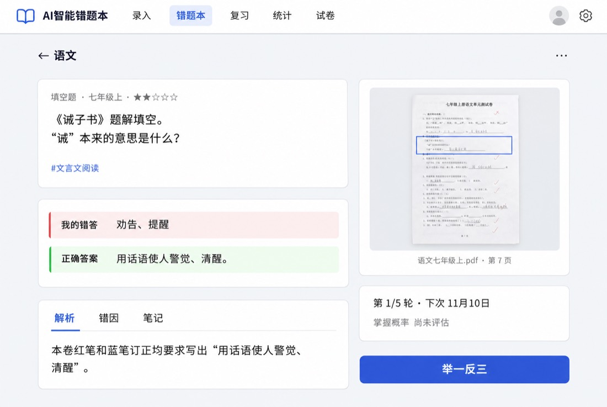

# User Guide

Student navigation uses **Today (`/`) / Notebooks (`/notebooks`) / Collection (`/collection`) / Me (`/me`)** in both Notebook and Simple styles. At 768px and above, an 88px left rail includes an avatar and a Photo shortcut that focuses image entry on Today. The avatar stays an empty circle of the same size while the session loads, then shows the user’s initial or a fallback only if no name is available. Phones use four bottom tabs with safe-area clearance and no floating buttons. The Learning group in Me contains history, statistics, exams and Uploads. The Settings group uses consistent rows for interface style, theme, settings and AI Agent access, with Background tasks last. Admin access (admins only) and logout follow. Logout clears local pending uploads and entry drafts first. Today shows recognition progress, failures and available results; Collection shows derived knowledge-point stickers with three-state filters and targeted practice links. Review sessions (`/review/session`) and checks (`/checks`) hide global navigation from initial loading. Only an empty queue or an error with no answerable content restores it. Save errors with a card still available keep focus, as does the review summary, which provides its own return link. Question details retain the tabs with actions above them.

An empty checks queue has one primary Back to today button, changed to Back when entered from a same-origin notebook or question detail page with return history. Opening `/practice` without a question ID replaces the route with `/notebooks` and shows no hint card. Stage timings on upload task cards are visible only to admins and start collapsed under Details.

Today (`/`) starts with the application-time-zone date, a greeting and estimated review minutes, then subject counts and estimates. Subject rows show read-only reviewed/total counts; the total combines today’s reviewed questions and the remaining budget queue. A checkmark and “Completed” appear when reviews are recorded today and the subject has no remaining questions. Rows with remaining questions enter single-subject review. Today and `/review` share the overview data source. At 1024px and above, tasks sit on the left and questions, status, weekly stickers and entry on the right. At 768–1023px the order is tasks, status, questions, weekly stickers, entry. Tablets initially expand six previews. Phones keep a single question-list toggle on the collapsed list card, with all questions available and math rendered. Recognition and pending checks share one paper card, hidden when empty. Loading uses skeletons and failures offer retry without fabricated zero counts. Entry comes last under “Got a new question wrong?” Touch devices show one Photo / Album / Files / Type row, with Photo opening the camera directly; desktop uses a shared drop area and Type button. A small link below opens AI assistant integration settings. Switching sources retains upload queues, draft recovery, confirmation and the `?notebook=` target. Text entry says “Paste your question here” with collapsed formatting help. Sticker rewards and review streaks use the read-only progress service.

## Create a notebook

When creating a notebook, choose its school stage (primary, junior high or senior high) and subject. They decide which knowledge-point library the AI uses and cannot be changed later, so keep separate notebooks per stage and subject.

Primary school offers math, English and Chinese. The built-in Chinese library includes chapters and knowledge points for grades 1–6, junior high and senior high. After upgrading Docker or an installation package, startup fills in missing built-in Chinese tags while preserving existing tag IDs, question links, custom tags and other tag systems.

After an administrator imports the PEP curriculum knowledge points (see [Settings and Users](Settings-and-Users-en)), a **Tag system** option appears when creating a notebook. It coexists with the built-in system and cannot be changed after creation; AI recognition and knowledge-point filters only use tags from the notebook's tag system.

Click a notebook cover to open its list, where you can rename or delete the notebook. Only an empty notebook can be deleted, so move or delete its questions first.

Notebook covers show subject colors, question totals, mastery progress and today’s review count. The simple style keeps the same structure without paper decoration. Search supports questions, knowledge points and 6-character IDs; press Enter on an ID to locate the question. On phones, the placeholder is shortened to “Search questions or ID”. At ≥1024px, a 320px notebook picker sits beside the selected notebook’s list; without a selection, a prompt appears on the right. The selected notebook has an outline highlight. Phones and portrait layouts open covers before navigating to a list. The header shows total, mastered and still-learning counts, with counted pill tabs. Review this notebook opens only this notebook’s part of the global daily-budget queue and is hidden when the count is zero. On iPad, it shares a row with Add and More; on phones, it spans the width below the title and statistics. Each statistic stays intact, with wrapping allowed between segments. Questions are grouped within the current page by import date and source file name (the same file on the same day forms one group), falling back to the first source-text segment. Previews omit repeated opening instructions and show the question, first knowledge point, mastery status, Today marker and wrong-attempt count or next review date. The Today marker follows the same daily-budget queue as Today, and today’s queue omits the duplicate next-review date. Questions due by the end of the application day, including overdue questions, that fall outside the budget show a muted “Queued” label with “Today's review time is full. Your turn will come later.” instead of a date. Future questions keep their next-review date. Only renderable SVG figures get thumbnails, loaded on demand. Questions with source images only show a paperclip source link; questions without either show no image indicator. The filter panel opens from the bottom on phones and from the right on desktop, combining grade/term, chapter, knowledge point, time, paper group and question type; active filters can be removed individually. Tabs and the filter panel use All / Still learning / Mastered (`all / unmastered / mastered`). Still learning combines internal `new` and `reviewing` states. Legacy `?mastery=new` and `?mastery=reviewing` retain their original exact filtering. Export for print, selection, similarity comparison, retagging, renaming and deletion are in More. Long-pressing a row also enters selection, with export, comparison and deletion in the bottom bar. Add questions from the header tools on phones and desktop. Lists load lightweight fields, figure URLs and source indicators; answers and explanations load on demand. Initial URL filters `?mastery=unmastered|new|reviewing|mastered` and `?tag=<tag name>` are preserved.

## Add questions

Recognition preserves Chinese and humanities tags for the detected subject. AI may name knowledge points when the notebook stage has no built-in curriculum tags.

Scanned PDF pages render at higher resolution for small text and formulas. Pages successfully recognized as having no questions are skipped, and submissions open the import center.

Joined question images use an 8192-pixel longest edge, about 24 megapixels and a 4MB size limit.

| Entry | When to use |
| --- | --- |
| Image upload, drag and drop, camera | Paper tests, workbooks and existing question images |
| Clipboard paste | Copied screenshots or images, with `Ctrl/⌘+V` |
| Screenshot | The browser supports screen sharing and the page runs in a secure context |
| AI solve | You already have the question text; Markdown and LaTeX are supported; tap **Import from file** to load a TXT / Markdown file |
| Files | Existing question bank files (JSON / Word / Excel / CSV / PDF), parsed and imported in batches |
| Type → Have an answer | Manually record a known question, answer and analysis |

Images can be cropped first. While cropping or selecting several questions, zoom with the mouse wheel, a two-finger pinch or the buttons at the top right (100%–500%; click the percentage to reset). When one image contains several questions, choose **Auto split** to let AI find each question (see "Multiple questions" below), or **Draw boxes** to select them for a batch import. Keep the full question, any required figure and the student's work, and avoid blurry images or cut-off conditions.

Phones and tablets use one row: **Take photo / Photo album / Files / Type**. Photo opens the camera directly; devices without a camera show a hint to use the album or files. The album supports multiple selection. The shared file picker accepts images, PDF, Word, Excel, CSV, TXT / Markdown and JSON. Images (including HEIC/HEIF without a MIME type) open the cropper; other files go to file import. Desktop uses a shared drop area and a Type button: drop, paste with Ctrl/⌘+V or click to choose images / files. A small screenshot button appears inside the drop area when supported. HEIC/HEIF photos are decoded from their real content and rotated upright before cropping; damaged or undecodable images show a specific reason.

Today and notebook add pages share the same source row, without a More menu or source tabs. The small **Batch import with an AI assistant** link below opens integration settings. Type keeps the AI solve / Have an answer choices. Switching sources preserves text drafts and file summaries.

Select up to 20 photos from the album at once. A single photo still opens the cropper; multiple photos first offer **One question per photo** or **Multiple questions per photo**. The first creates recognition tasks; the second creates a split-preview batch per photo for review before solving individual questions. View results in Recognition Tasks; AI consent, quotas and the confirmation-before-import preference still apply. After submission, tap “Take the next photo” to open the camera immediately while recognition continues. Finish or discard staged question parts before selecting multiple photos.

For single photos, album selections, manually boxed questions and photo auto-splitting from the entry page, compressed photos and upload parameters are saved in this browser before transmission and removed only after successful submission. Network failures, timeouts and server errors keep the photos and retry with exponential backoff; going online, returning to the page or tapping Retry resumes uploads. Business errors such as exhausted quotas, missing AI consent or unsupported formats show a reason and stop automatic retries; resolve them and retry manually or delete the photo. Queues are isolated by account and cleared on sign-out or account deletion. They stay in this browser and are not transferred by backups or device changes. If IndexedDB is disabled or storage is full, direct upload is used without guaranteed retention of failed photos. Tasks already on the server remain available in Recognition Tasks.

When one question spans two or more sheets, frame the first part in single-question crop and tap **Rest is on another sheet**; that part is saved above the upload area. Take or choose the next photo, frame the continuing part and tap **Join … parts and recognize**: the parts are scaled to the same width and joined top to bottom into one image. A question can have up to 4 parts; while parts are saved you can also start recognition or discard them from the saved-parts panel, and cropping offers only the single-question mode.

The crop preview uses a thumbnail; after you confirm, the crop is taken from the original. Output is limited by a 4096 px long edge, about 4.9 megapixels and 1.5 MB together, with JPEG quality at 0.8 or above, so small text, formulas and figures stay sharp.

After enabling "Review before import" in "Settings → General", you can correct the recognition on the review page before saving. The AI may misread numbers, symbols and figure relationships, so check against the original before saving.

Today and notebook add pages share one source row. Type includes **AI solve** and **Have an answer**. Switching entries preserves input and file summaries. Text drafts are scoped by account and notebook in the current tab, survive refresh, and are cleared on sign-out or account deletion. They are not backed up; if session storage is unavailable they only persist within the current page. Optional direct-entry fields are collapsed.

Album selections (up to 20 photos) offer **One question per photo** or **Multiple questions per photo**. The latter creates a split-preview batch per photo, ready for confirmation in Recognition Tasks before solving individual questions. TXT / Markdown files selected under Files automatically open in Text; question-bank files selected under Text continue parsing without reselection.

The **Next: preview N questions** button creates preview batches; questions are only saved after the final import action. When all selected questions have answers, **Import as-is** is recommended by default. AI tagging and full solving remain optional, and edits, selection changes or undo do not override an explicit mode choice. The action bar states whether AI is used, and results distinguish saved, review-needed, failed and duplicate questions. A sole notebook is selected automatically, and a notebook can be created beside the selector.


### Import question files

The **Files** entry on the home page and notebook pages imports existing question bank files. Parsed questions are imported in batches and can be saved **as-is** (no AI call). Supported formats:

| Format | Extension | Max size | Notes |
| --- | --- | --- | --- |
| JSON (question exchange format v1) | .json | 50 MB | The app's exchange format with the richest fields |
| Word | .docx | 50 MB | Paragraphs, auto numbering, tables and inline tags |
| Excel | .xlsx | 20 MB | Header row detected; sheet names used as sections when there is no section column |
| CSV | .csv | 10 MB | Comma/semicolon/tab and UTF-8/UTF-16/GBK auto-detected |
| PDF | .pdf | 50 MB | Requires a text layer; scanned PDFs auto-convert to images for AI recognition (see below) |

- **Flow**: choose a file → parse (with progress) → image composition (if any) → summary (total questions, parse errors with reasons, warnings, not-yet-imported fields) → choose a target notebook (required) → create batches and go to the import center. At most 2000 questions per import; questions with parse errors are not imported.
- **Not-yet-imported fields**: subject, grade/semester, source, figure SVG and extension fields are not written to the draft yet; the import summary shows how many questions carry each.
- **Templates**: Excel / CSV templates (with sample data and column descriptions) can be downloaded from the import page; column names accept Chinese and English.
- **Not yet supported**: image formats browsers cannot render (TIFF, etc.) are skipped with a warning; legacy .doc binary files must first be saved as .docx in Word before importing.

The JSON question exchange format is documented in the [question exchange format spec](../QUESTION_FORMAT.en.md).

#### Word (.docx) content

- **Supported content**: normal paragraphs, auto-numbered paragraphs, tables (cells joined with tabs), inline tags such as 【答案】 (answer), 【解析】 (analysis), 【知识点】 (knowledge points), 【难度】 (difficulty) and 【错答】 (wrong answer), as well as an "参考答案" answer section filled back by question number.
- **Auto numbering**: numbers from Word auto-numbering are not in the text; the parser computes them from `numbering.xml` (e.g. "1.", "一、", "（三）"). Common formats include decimal, Chinese counting (一、二、三…), enclosed circle digits (①②③), upper/lowercase letters and Roman numerals.
- **Superscripts and subscripts**: superscripts are output as `^{…}` (pure digits as `^2`, e.g. x^2), and subscripts as `_{…}` (same rule, e.g. `a_{n+1}`).
- **Word formulas**: formulas inserted with Word's built-in equation editor (Insert → Equation) are converted to LaTeX for KaTeX rendering — inline formulas become `$…$` and display equations become `$$…$$`; fractions, radicals, superscripts/subscripts, ∑/∫/∏, equation systems, matrices and other common structures are supported. OLE equation objects such as MathType (a `w:object` placed directly inside a run) are not OMML: their WMF preview images are first analyzed for structural recovery — simple formulas (fractions, superscripts/subscripts, common symbols such as ×÷≤≥≠π°) are converted to LaTeX and embedded in place in the text (`$…$` style, consistent with OMML), counted as `OLE_EQUATION_LATEX:N` in the import warnings; complex formulas (radicals, geometric shapes, multiple diagonal lines, etc.) that cannot be reliably recovered are kept as images, with the formula position marked as "[公式]" in the text and counted as `OLE_EQUATION_IMAGE:N` and `METAFILE_RENDERED:N`. EMF preview images are not rendered yet and are counted in `METAFILE_FAILED:N` (MathType equations are almost always WMF). Unrecognized OMML structures keep their text and are reported in the `MATH_UNSUPPORTED:元素名` warning. Legacy .doc binary files must first be saved as .docx in Word before importing.
- **Images**: embedded images in Word (w:drawing and w:pict) are imported as the question's original image — images in the question body, answer, and analysis are attributed to the corresponding question in order of appearance; multiple images are merged vertically into one and compressed to a long edge of ≤ 1600 pixels and about ≤ 1 MB. WMF preview images of OLE equation objects (MathType / Equation Editor) are rasterized during import and kept in the question's original image (the formula position is marked as "[图片]" in the text; render counts appear in the import summary as `METAFILE_RENDERED:N`, failures as `METAFILE_FAILED:N` — EMF preview images are not rendered yet and are also counted as failures; when a question has more than 12 small equation images, the extras are not merged, counted in `METAFILE_TRUNCATED:N`). TIFF and other formats that browsers cannot render are not supported (counted in the `IMAGE_UNSUPPORTED:format` warning) and appear as the "[图片]" placeholder in the text.
- **Strikethrough and hidden text**: skipped during parsing; revisions keep insertions and skip deletions.
- **PDF text layer**: PDF files must have a text layer (text embedded by Word or a generator, selectable in a viewer). Double-column layouts are read left column first, then right; repeated headers and footers (including page numbers such as "Page 3" or "- 3 -") are removed. Scanned PDFs have no text layer; when imported, the app shows "This is a scanned PDF" and lets you pick a page range (up to 20 pages per import) to convert to images, which are then recognized and split by AI — each page uses one AI split quota. A PDF with a text layer but some blank pages imports normally using the text layer, and the warning notes the blank page count. Password-protected PDFs are not supported.
- **PDF question images**: when importing a text-layer PDF, every question is captured by default as a screenshot of its layout region and saved as the question's original image, so you can always see how the question originally looked (formulas, figures and tables stay intact even if the text layer is garbled). On the summary page, "Question images" can be changed to "Questions with graphics" (only questions with detected pictures, geometric figures, function graphs or table lines; unavailable when the PDF has no graphics) or "Do not save". Questions spanning columns or pages are cropped in segments and stacked vertically, compressed to a long edge of ≤ 1600 pixels and about ≤ 1 MB; the question text is still imported normally.
- **AI full solve recognizes questions with an original image from the image**: when a question carries an original image (PDF screenshot or merged Word embedded image) and you choose **AI full solve**, the model recognizes the question from the image and the file's text layer is only passed along as a reference (the text layer often garbles formulas and layout, so the image is authoritative). These questions count as image recognition uses. **AI tags & difficulty only** and **Import as-is** never invoke full recognition and are unaffected.

#### Excel / CSV column names

See "Excel / CSV question templates" below.

### Multiple questions

You do not need to paste or crop questions one at a time:

- **Text**: paste a whole worksheet into **AI solve**. Below the box you see "N numbered questions detected" as you type (local rules based on question numbers, no AI call). Tap **Preview N questions** to open the preview, or **Solve as one question** to keep a single question. A TXT / Markdown file with the question text (up to 2 MB) can be loaded with **Import from file** at the top right of the box; UTF-8 / UTF-16 / GBK and other common encodings are detected automatically. If the box already has text you are asked whether to replace it or append the file content at the end. Options (A–D) and sub-questions ((1)(2), ①②) stay with their question; reading passages become shared material placed before the related questions; titles, name/date lines and notes such as "9 questions in total" are left out and can be restored from **Not counted as questions**. Section headings (such as "兴趣篇" or "一、选择题") after which numbering restarts at 1 are also handled: each section's questions are split correctly and tagged with the section heading. Numbers right after a question stem, such as 1) 2) or "answer the following questions:", may be sub-questions of one question, so they are kept together by default; choose **Split into N questions anyway** if they really are separate. A batch holds up to 60 questions. If the text exceeds 20,000 characters or the local split finds more than 60 questions, it is automatically split into multiple batches (each up to 60 questions) and the UI shows "Split into N batches"; each batch appears separately in **Import tasks**. For several questions without numbers, use **Split with AI**: one AI call finds the boundaries, and the question text is always taken from what you pasted. When wrong numbers (for example from OCR) make the local split go wrong, **Split wrong? Split with AI** is also shown below the detection notice.
- **Photo**: after choosing a photo, switch the crop window to **Auto split**, optionally crop to the worksheet (the whole photo by default), and tap **Find questions**. This needs an AI model with image input. The photo is recognized on the server, so you can leave the page. Questions the model cannot locate reliably are marked **Not located**, left unselected and need to be marked on the photo; blurry or partial photos show a warning. **Single question** and **Draw boxes** remain available.

Web photo and scanned PDF imports retain the uploaded full-page image for traceability. Questions from the same page share a source page by image hash and use the draft regions at save time. Single-photo imports retain the compressed task image with a full-page region. Scanned PDFs retain the rendered page, file name and page number, using a full-page region when no location is available. Duplicate questions keep their existing source, and retries do not create duplicate regions. Plain text, spreadsheets and Word text do not create source pages.

**Answer and analysis markers**: when a question contains reference answers, analysis, knowledge points, difficulty or the student's wrong answer written with line-leading markers, they are recognized automatically and filled into the matching fields of the draft (no longer mixed into the question text), and are passed to the AI as reference when solving. Supported markers: `【答案】`/`答案：`/`【参考答案】`/`Answer:` for the answer; `【解析】`/`解析：`/`【分析】`/`【详解】`/`【解答】`/`【点评】` for the analysis (multiple markers are merged as separate paragraphs); `【知识点】`/`知识点：`/`【考点】`/`考点：` for knowledge points (separated by 、, ，or ；); `【难度】`/`难度：` for difficulty (a number 1–5, a count of ★, or 易/较易/中等/较难/难); `【错答】`/`我的答案：`/`学生答案：` for the student's wrong answer. Both half-width and full-width colons and brackets are accepted. In an answer section at the end of the worksheet ("参考答案" or "答案与解析"), entries that start with a question number (such as "1. B" or "2．答案：12 解析：……") are filled back into the matching question's answer and analysis; entries that do not match any question number stay under **Not counted as questions**. Open a question in the split preview to review and edit these fields.

The preview shows "N questions found · N selected". Each question starts collapsed; open it to edit, split at the cursor, merge with the previous question, move it or delete it, with select-all and undo at the top. Photo questions are outlined with numbered boxes on the original; use **Adjust area** to reframe one (a question can have several areas, such as a stem and a figure in different columns). The text shown for photo questions only helps you recognize them; each question is recognized again from its area after you start.

When a question continues from this page onto the next, tap **Continues on next page** on it (shown for questions marked as possibly cut off and for the last question on each page) and take or choose the next page. The app scales this question's part of the page to match the next page's width, places it above the whole next page in one image and sends it to AI auto split as the next batch; the question is moved out of this batch (you can undo) and appears whole in the next batch. A "Page 2 is being split" notice with a link appears at the top; solve and import the rest of this batch as usual, then open the next batch to confirm. If the last question of the next batch continues again, repeat. The next batch uses the same notebook, and the split counts as one AI use. If the next batch splits the question in two, use **Merge with previous** to join them.

When text questions come from OCR or contain scratch work, tap **AI fix text (N)** at the top to fix the selected questions, or **AI fix text** inside an opened question to fix just that one. The AI only removes scratch work, working and crossed-out text and fixes OCR typos such as look-alike characters and punctuation; numbers, formulas, units and question numbers stay as they are, and nothing is added. Parts it is unsure about are listed under **Not sure, kept as is**. Each result appears as an **AI suggested fix** with removed text struck out and changes highlighted; **Accept fix** replaces the question text and **Keep original** discards the suggestion, or use **Accept all** for several questions. Results that change or add numbers are discarded and those questions keep their original text. Suggestions are saved with the preview; editing the question text by hand discards its suggestion. If suggestions are still pending when you start, you are reminded and those questions are solved with their original text. Each fix request counts as one AI use. While a fix is running, you cannot start another one for the same batch (the server prevents duplicates by target); refresh the page to keep waiting and retrieve the result automatically, or check progress later under **Background tasks**. Changes are saved to the server automatically, so refreshing, locking the phone or opening it on another device shows the same preview; if two pages edit at once, the later save is told and loads the latest version.

Start with the button at the bottom: with **Review before import** off it reads **Solve and import N questions** and saves each question when solved; with it on it reads **Solve N questions, review later**, and you **Review** each one (saving returns to the batch) or choose **Import the other N as recognized**. The batch appears as "Batch of N questions" under Recognition tasks with counts of imported, duplicate, to-review and failed questions; percentages are stage estimates. Failed questions can be retried individually or together; finished questions are never solved or imported twice.

Text batches offer three analysis modes in the start bar (defaulting to **Import as-is** when every selected question has an answer):

| Analysis mode | Description |
| --- | --- |
| AI full solve | AI recognizes each question, generates the answer and analysis, and tags it; each question counts as one recognition use. Questions that carry an original image (PDF screenshot or merged Word embedded image) are recognized from the image — the file's text layer is only passed to the model as a reference — and count as image recognition uses |
| AI tags & difficulty only | Keeps the draft question text, answer and analysis; AI only fills in missing knowledge points, difficulty stars and question type; each question counts as one retag use, costing far less than a full solve |
| Import as-is | No AI call and no quota used; questions are saved exactly as in the draft—the question text, answer, analysis, knowledge points, difficulty and wrong answer all come from the draft |

**AI tags & difficulty only** and **Import as-is** require a target notebook to be chosen first; the subject is taken from the target notebook's name. If there are more than 5 knowledge points, only the first 5 are kept. When tag suggestion fails or the daily quota is exceeded, the question is still imported with its original fields. Retrying a failed save only retries saving and never calls AI.

### Recognition tasks

Once the upload finishes, recognition continues on the server. The page shows a status card instead of a full-screen overlay, so you can leave the page, lock your phone or keep adding questions. The **Recognition** entry in Today’s status card shows how many tasks are running and the number of unread results, and refreshes as soon as you return to the app.

| Status | Meaning and actions |
| --- | --- |
| Recognizing | The server is calling the AI; the percentage is a per-stage estimate |
| Ready for review | The result when review before import is on. **Continue review** opens the review page; reloading, another tab or another device opens the same result without recognizing again |
| Saving / Saved | Saved tasks offer **View question**; duplicates are recorded in the existing question's practice history |
| Failed | Shows the reason and offers **Retry**. If a recognition result already exists, only the save is retried without calling the AI again. Tasks interrupted by a server restart also show as failed |

Drafts awaiting review and failed tasks are kept until you handle or discard them; saved tasks are kept for 7 days. Each task card lists the actual time spent reading, converting, cropping, compressing, receiving, recognizing and saving.

### Excel / CSV question templates

If you already have a question bank in Excel (.xlsx) or CSV format, you can import it directly: the app recognizes the header row and reads question text, answers, analysis and other fields from the columns. There is no need to paste questions one by one, and questions that already include answers and analysis are imported without calling the AI.

**Column names** (Chinese or English; case, full/half-width characters and whitespace are ignored):

| Column | Description |
| --- | --- |
| 题干 / 题目 / question / text / stem | Question text (required) |
| 选项A, 选项B, … | Choice options; when non-empty they are appended to the question text as "A．option" |
| 答案 / 参考答案 / answer | Reference answer |
| 解析 / 答案解析 / analysis / explanation | Answer analysis |
| 知识点 / 考点 / knowledge / tags | Multiple knowledge points separated by 、, ，or ； |
| 难度 / 难度星级 / difficulty | A number 1–5, a count of ★, or 易/较易/中等/较难/难; also accepts a 0–1 difficulty score (≥0.8→1 star, ≥0.6→2 stars, ≥0.4→3 stars, ≥0.2→4 stars, below→5 stars) |
| 大题 / 题型分组 / section | Section title; when using multiple worksheets the sheet name is used if no section column is present |
| 题号 / 序号 / no / label | Original question number |
| 材料 / 阅读材料 / material | Shared reading material |
| 错答 / 我的答案 / wrongAnswer | The student's wrong answer |
| 学科 / 科目 / subject | Subject name |
| 年级学期 / grade / gradeSemester | Grade and semester |
| 来源 / 出处 / source | Question source |
| 题型 / type / questionType | Question type (e.g. multiple choice, fill in the blank) |

CSV files automatically detect comma, semicolon or tab delimiters; UTF-8, UTF-16 and GBK encodings are supported (CSV files exported from Excel in Chinese can be imported directly).

## Duplicate detection

On import, the question text is compared with the current user's existing questions across all notebooks. The default threshold is 90% and can be changed in your general settings.

- When the similarity is **strictly greater** than the threshold, the existing question is returned and a wrong attempt is recorded on it.
- A similarity equal to the threshold does not count as exceeding it.
- Similarity is the character edit similarity of the normalized question text; it does not mean the math is the same.
- Records from repeated imports feed into later mastery evaluation; check the original question's answer history when needed.

Notebooks also offer a two-question similarity comparison to help decide whether the threshold suits your questions. If only a few characters of numbers or conditions differ, the similarity may still be high, so judge by the meaning of the question.

## Question details

Question details show a notebook and first-tag breadcrumb. The left paper card contains question type, grade/semester, read-only difficulty stars (changed only in edit mode), Markdown and math content, figures and tags. Reliably parsed choices appear as separate cards, with green outlines and pale backgrounds for known correct choices. Wrong answers use high-contrast red ink with a fine strikethrough, and correct answers use green highlighting. Analysis, mistakes and notes are tabbed. Short existing error types appear as stickers, while long explanations stay in the body. Empty content offers an editing hint. At widths of 1024px and above, a 60% / 40% layout places the taped Original paper photo card, review progress and Try a similar question on the right. The preview is 180px high with yellow highlights at actual region coordinates. Legacy images without coordinates remain viewable. Captions show available file names, page numbers and source text, without inventing original question numbers. Without a file name, the title line is omitted and the viewer uses “Original image” as its accessible name. Dots count completed review rounds, with total rounds and the next date in the summary. Opening it retains schedule adjustments, mastery probability, practice history and result entry. Phones use one column with the main action above the four bottom tabs. Simple style retains the structure with paper, tape and handwriting decorations disabled.

The More menu has four groups. Editing contains Edit question and Replace original image. Let AI redo contains Regenerate solution, Re-recognize knowledge points and Regenerate figure, with Fix LaTeX shown only when formula issues are detected. Explanations contains animation and GeoGebra entries according to capability settings. The last group contains Copy question ID, Report a problem and destructive Delete. Tools retain existing panels, task recovery and overwrite/deletion confirmations.

Ungenerated animations and GeoGebra have no placeholders in the main content. Unified editing covers the question, correct answer, wrong answer and status, analysis, mistakes, notes, question type, grade/semester, notebook, paper group, tags and difficulty. Only changed fields are saved, and cancelling unsaved changes requires confirmation. Notes retain their separate endpoint. Partial failures preserve drafts and retries submit only remaining changes. Opening an original image shows a full-screen source viewer with blue question-region outlines, a dimmed background outside the regions, numbered multiple regions and initial focus on the first region. Pinch or wheel to zoom, drag to pan, or use the zoom and reset buttons. The footer shows the available file name and page (omitting this line without a file name), date and import method. Cross-page questions offer a page selector, and older questions without a source page show their question image. The desktop sidebar previews the full page with region outlines.

| Information or action | Notes |
| --- | --- |
| 6-character question ID | Use **More → Copy question ID** and locate the question by ID in a notebook; shown as the source ID in printouts |
| 1–5 star difficulty | Rated by the AI with reference to competition-math difficulty; can be changed manually |
| Grade/semester | Use **More → Edit question** to change and save it; review also offers a selector, and loading the profile preserves manual edits |
| Paper level | When not set, 1–3 stars default to the "Paper A" group and 4–5 stars to the "Paper B" group; a manual choice takes priority. Customize groups in **Settings → General → Paper Groups**: rename defaults, add custom groups (e.g. Unit Test, Midterm, Final), deactivate or delete custom groups |
| Knowledge points | Tags from the matching stage and subject; re-recognize one question or a whole notebook |
| Regenerate solution | Generates a new answer and analysis; asks for confirmation before overwriting |
| Fix LaTeX | Run AI repair from More when formula syntax issues are detected |
| Original image | View, replace or add it to check the recognition |

Unrated questions are not assigned a paper level by the default rule alone. Regenerating the full solution keeps the knowledge points and mistake information.



Choose a fixed grade or AI recognition for new questions under **Settings → General**. Manual choices take priority; see [Settings and Users](Settings-and-Users-en).

## Figures and animated explanations

- **SVG figures**: static SVG generated by the AI from the question, used on the detail page, in practice and in printouts; the original image can still be viewed separately.
- **Figure display scale and alignment**: saved mistakes with a figure show this setting on the details page. Enter a percentage or drag the slider to preview, from 10–200% (default 100%), and choose an alignment (left / center / right, default center); exam papers with figures also allow adjusting scale and alignment per question or uniformly across the exam. Click **Save** to apply it after reload and in printouts. **Reset to 100%** restores the default scale; save again to keep it. Enlarged figures fit the available width and keep their aspect ratio. Backups retain the scale and alignment; existing questions and older backups default to 100% and center. **Image Scale** in print preview controls the original photo; enable **Question Text** to print the figure.
- **SVG animated explanations**: the animation stays paused on the first frame when opened or changed; click Play to start. The player supports pause, seeking, replay and full screen. Narration explains how key steps are derived and why they work. On-screen work or tables show routine calculations. Complex problems can run longer than 40 seconds, with playback time allocated for the closing narration. Enabled by default in personal settings. Click the speaker icon in the player to turn on voice narration (off by default and remembered once on). Each step is read aloud (by the browser's speech synthesis by default; when an admin turns on cloud voice, the server synthesizes it so every device hears the same voice), the animation waits for the narration before moving on (it pauses on the complete current step and highlights the frame border while waiting), and the speed cycles between 0.75× and 1.5×. Older animations without a narration script read the subtitles at the bottom of the picture. Click **Add narration** above the animation to have AI write a script for the existing picture without regenerating the animation (counts as one animated-explanation AI use). When a script exists, the button reads **Rewrite narration**. With cloud voice on, turning on narration for the first time synthesizes the whole animation's voice at once, and **Regenerate voice** above the animation synthesizes it again; both appear in background tasks with progress (they use the speech provider's quota, not the AI daily limit). Animations whose cloud voice has been generated open with narration on. Animation text follows the interface language; Chinese and English versions are generated and saved separately, and switching the language shows the matching version automatically.
- **GeoGebra interactive demos**: interactive figures for math and physics questions; disabled by default in personal settings.

Generated animations and GeoGebra demos can be deleted after confirmation. Check generated figures and solutions manually, especially geometric positions, counting steps and conclusions.

## Filters and batch actions

Filter by mastery status, knowledge point, question type, time, grade and semester, or paper level, then act on the results in bulk or print them. Question types support multi-select, including "Not set" (questions without a question type). The multi-select bar's **Export** offers three formats for selected error items (see [Question Exchange Format](../QUESTION_FORMAT.md)): **JSON** has the most complete fields and suits backups or migration; **Excel** columns match the question bank import template so it can be re-imported directly; **Word** is designed for printing as an exam paper, with answers and analysis collected in an "参考答案" section at the end, and formulas exported as LaTeX text. All three formats contain only question content, without practice records or other data; for a full backup use **Settings → Data Management → Export Data**. Before deleting, confirm the filters and selection; [back up your data](Backup-and-Restore-en) when it must be kept long term.

## Markdown and formulas

Multiline formula delimiters (such as aligned derivations and cases systems) are normalized automatically for display. Text following the formula is preserved, and existing questions do not need to be re-analyzed.

Questions, answers and analysis support Markdown, and formulas are rendered with KaTeX:

```text
Inline: $a^2+b^2=c^2$ or \(a^2+b^2=c^2\)
Display: $$\frac{a}{b}$$ or \[\frac{a}{b}\]
```

While editing you can switch between source and preview. For complex tables and formulas, see the [Markdown guide](https://github.com/shuiguojiao/wrong-notebook/blob/main/doc/MARKDOWN_GUIDE.md) and the [table recognition notes](https://github.com/shuiguojiao/wrong-notebook/blob/main/doc/TABLE_RECOGNITION.md).

Next: [Practice and Exams](Practice-and-Exams-en).

## View the original while reviewing

Original images stay hidden by default while answering. If a question explicitly needs an image or refers to a figure or table, has no SVG figure or figure preview, and has an original image, a secondary View original button appears below the question with “The original image may contain answers”. It opens the same source viewer used after submission. Questions with a figure or without an original image have no button. The Original paper card after submission is unchanged.

## Daily review reminders

Enable reminders under Settings → General → Review reminders. Each account selects one channel and a daily time in the application time zone. Save before testing; no due questions are required, and tests are limited to once per minute. Reminders default to off. Automatic messages contain due counts and subjects, with one successful send per day and at most two retries after failure. Service acceptance does not verify device receipt. The server must remain running; a late start checks only the current day.

- **Bark (iOS)**: install the app and copy the device key or `https://api.day.app/<key>`.
- **ServerChan**: sign in at `sct.ftqq.com`, connect a receiver and copy the SendKey.
- **PushPlus**: sign in at `www.pushplus.plus`, connect a receiver and copy the token.
- **WeCom**: add a group bot and copy `https://qyapi.weixin.qq.com/cgi-bin/webhook/send?key=...`.
- **Feishu**: add a custom bot in group settings and copy `https://open.feishu.cn/open-apis/bot/v2/hook/...`.
- **DingTalk**: add a custom bot through the group assistant and copy `https://oapi.dingtalk.com/robot/send?access_token=...`. Include `错题本复习提醒` if using keyword restrictions; additional dynamic signing is not supported.
- **Custom webhook**: requires administrator approval and receives HTTPS POST JSON `{title, body, url?}`. Private networks are denied unless separately enabled. Self-hosted Bark can use a compatible full HTTPS endpoint.

Only the credential's last four characters are shown. Leave the input blank to preserve it; changing channels requires a new credential. Enabling reminders sends due counts and subjects to your selected third-party service. Credentials are included in personal plaintext backups. An administrator must set `NEXTAUTH_URL` for review links; otherwise the message omits the link and Settings shows a notice. `REVIEW_REMINDERS_ENABLED=false` globally disables reminders and tests. See the [reminder guide](https://github.com/shuiguojiao/wrong-notebook/blob/main/doc/REVIEW_REMINDERS.en.md) for deployment, security and crash/timeout limitations.


## Problem reports

On a question detail page, choose “Report a problem”, select a category and describe the issue. Submission saves a snapshot of the question, answer, explanation, tags, subject, grade, entry method, source and traceable AI provider/model used at entry. Original images and image addresses are excluded; only their presence is recorded. Admins filter reports by status/category and respond on the admin dashboard, without links into complete user notebooks. Users return to the same question’s report dialog to see Open, Resolved or Won’t fix and the admin note. Each user can submit up to 30 reports per day in the application time zone.

## Needs a quick look

A check entry in the shared status paper card on the home and review home pages appears only when questions need checking. Import results show the affected count for that import and refresh to pick up background AI results. Cards handle text differences, mismatched images, and missing figures one issue at a time. Text suggestions replace one exact occurrence. Adjust regions inside the source viewer using mouse, touch, or keyboard, with up to four regions. Questions without a source page use the existing image upload or replacement flow. Dismissing remembers the same code and field for that question. Deletion requires confirmation. An empty queue explains that newly imported questions are checked automatically. Return to the previous page, go back to today (`/`), or open notebooks (`/notebooks`). Loading and saving errors also offer the today and notebook exits. Concurrent changes prompt a fresh review.


### Collection and review streaks

Collection shows all related knowledge-point stickers, grouped by user, subject and tag system, with stable ordering and state filters. A subject with one tag system hides its system name. Subjects with multiple systems use subsections with one system heading each, retaining that context when filtered by state. A sticker is Earned when all its questions are mastered; otherwise it is Improving when there is at least one valid answer and all valid answers in the last 30 application days are correct. Other stickers show the number of unmastered questions and link to that knowledge point’s unmastered list within its tag system. Improving and unfinished stickers are clickable across the whole sticker, with a small “Practice this ›” hint at the bottom right linking to the existing unmastered list. Earned stickers remain non-interactive, and stickers align by grid row. Tags without questions are excluded; undo, deletion and retagging recalculate the result. The streak stamp sits to the right of the greeting and is smaller on phones, with its label, number and day unit on separate lines. Weekly rewards use stickers with a Collection link and are hidden when empty. At 1024px and above, they follow questions and status in the right column, before entry. In a single column, they follow the task note, status and questions. Today shows the review streak and verifiable New stickers this week (weeks start Monday). This release confirms first mastery only when a knowledge point’s questions each have a single valid answer evaluated on that same application day; uncertain dates are omitted from weekly rewards while earned stickers remain in Collection. The first release approximates a completed day as one with at least one valid original-review answer in the application time zone. Imports, skips, manual scheduling, duplicate imports and similar-question practice do not count. Before today’s first review, the streak ends yesterday and says Review today to keep going. This is separate from active days in the statistics calendar. All progress is derived without new tables or backup-format changes.

## More paper and focused writing

Tap More paper at the bottom or write near the lower edge to extend the paper by 750 logical units, up to 3000. Undo, redo and rotation preserve paper height and existing ink. With Pencil-only writing enabled, drag the paper with a finger; otherwise use the 24px scrollbar on the right. The out-of-paper prompt switches to Photo. Long answers export in paper-aligned segments of 1300 logical units at 1000px wide, with up to 4 handwriting images and photos combined. Excess images block submission and prompt you to delete a photo or erase some ink, keeping your answer intact.

Expand on the toolbar opens focused writing. Tap the single-line question to view its full text, math and figures, with Collapse and the protected submit button on the right. Collapse or Esc keeps the same paper, ink and tool settings. New questions start collapsed; there is no draft page.
